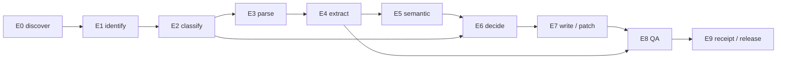

# Binary engines (DOW)

Read-only engines that take stock of a folder of office files, drawings and
archives, read their structure, and
propose (never perform) how to tidy them. They sit next to
`DMAIC_V3/tools/dow_engine.py` and `keb_engine.py`: what
they extract is candidate knowledge for the DOW knowledge extractor, never
accepted knowledge.

Nothing here contains data. Site-specific values live in a private
configuration, and every output goes to a data
folder outside the repository.

## What the engines do

- **Engine:**  `estate_inventory.py`
  - **Stages:**  E0-E2
  - **What it does:**  Lists the top-level files of one root (and the `GG_*`
      folders it created), proves each type from its bytes, hashes it, sorts it
      by type (A-K) and epic, finds duplicates and older versions, and ranks ZIP
      families by reverse Kahn (newest tip first).
- **Engine:**  `estate_probe.py`
  - **Stages:**  E3-E4
  - **What it does:**  Opens each file read-only and extracts structure:
      outline, bullet and number levels, fonts, colours, sizes, text boxes,
      tables, formulas, TOC, connectors as graph edges. Files with no epic by
      name are re-sorted by their text. Stored text samples are scrubbed of
      secret-shaped strings.
- **Engine:**  `estate_scaffold.py`
  - **Stages:**  E5
  - **What it does:**  Writes one `TYPE.gg_Engine` folder per type (manifest,
      capability matrix, SIPOC per lane, queue, skill, rules, ADR) and the
      estate graph.
- **Engine:**  `estate_moveplan.py`
  - **Stages:**  E6
  - **What it does:**  Proposes a destination for every file and says why a file
      is held back (git-tracked, open in Office, online-only, path too long,
      destination exists).
- **Engine:**  `Invoke-EstateMove.ps1`
  - **Stages:**  E7
  - **What it does:**  Applies the move plan. Dry run unless `-Execute`;
      re-checks hash, lock and destination before each move and logs each move
      as it happens, so any run can be undone (`-Undo`).
- **Engine:**  `deep_graph.py`
  - **Stages:**  E4-E5
  - **What it does:**  Reads drawings (PPTX, SVG, VSDX, drawio, Mermaid, SVG
      inside HTML) into one graph format: nodes, edges with direction, legend,
      styles, QA.
- **Engine:**  `slide_atlas.py`
  - **Stages:**  E4-E6
  - **What it does:**  Compares every slide of every deck: exact copies,
      restyles, remakes (before/after), slide families, style flags. Writes a
      static compare page.
- **Engine:**  `reference_test.py`
  - **Stages:**  E8
  - **What it does:**  Scores the drawing reader: R1 answer key, R2 crosswalk,
      R3 adversarial (must not guess), R4 read-only, R5 hand-labelled pilot.
- **Engine:**  `truth_status.py`
  - **Stages:**  E6
  - **What it does:**  Matches inventory hashes against a pin map (`{sha256:
      ["repo:path", ...]}`, collected elsewhere from repository manifests):
      `AUTHORITATIVE` (pinned by a canonical manifest), `RECORDED` (pinned only
      under archive, incubator, history, receipt or triage paths), `SUPERSEDED`
      (unpinned older version), `STALE_RELEVANT` (unpinned newest version of a
      pinned family), `UNPINNED`. Pure matching: it never runs git.
- **Engine:**  `thread_promote.py`
  - **Stages:**  E9
  - **What it does:**  The only way a candidate link becomes accepted (see
      below).
- **Engine:**  `html_shot.py`
  - **Stages:**  E8
  - **What it does:**  Renders HTML pages in Chromium (Playwright) and reports
      console errors and overflow.
- **Engine:**  `public_safety_scan.py`
  - **Stages:**  gate
  - **What it does:**  Checks files before they go to a public repository:
      private markers, user paths, secret-shaped strings, Python that only
      parses on 3.12+.
- **Engine:**  `estate_spec.py`
  - **Stages:**  -
  - **What it does:**  The one source of types, lanes, the DAG, capabilities,
      and the configuration loader.
- **Engine:**  `git_readonly.py`
  - **Stages:**  -
  - **What it does:**  Reads HEAD, tracked paths and bundle heads from disk. git
      is never run, so an inventory cannot write into a checkout.
- **Engine:**  `ggmath_bridge.py`
  - **Stages:**  -
  - **What it does:**  Loads the gg_MATH kernels at a pinned commit (see below).

## The E0-E9 DAG and the lanes



- **Lane:**  L1 intake
  - **Stages:**  E0-E2
  - **Core function:**  discover, identify (bytes, not extension), hash, dedupe,
      lock detection
- **Lane:**  L2 read and parse
  - **Stages:**  E3
  - **Core function:**  open read-only, parse package parts, slice into pages,
      slides, sheets, sections
- **Lane:**  L3 extract
  - **Stages:**  E4
  - **Core function:**  levels, fonts, colours, sizes, text boxes, shapes as a
      graph
- **Lane:**  L4 semantic
  - **Stages:**  E5-E6
  - **Core function:**  meaning, links, staleness, a decision per file
- **Lane:**  L5 write and patch
  - **Stages:**  E7
  - **Core function:**  copies only; originals are never overwritten
- **Lane:**  L6 QA and release
  - **Stages:**  E8-E9
  - **Core function:**  checks, receipts, release

Decisions at E6: `KEEP_CANONICAL`, `REWORK`, `SUPERSEDED`, `STALE_ARCHIVE`,
`DUPLICATE`, `ACTIVATE_ZIP`, `PARK`.

## Pathways

A pathway is what a person asks for; it runs the stages it needs, in DAG order.
Run the engines in this order
(every command is read-only except the last one with `-Execute`):

- **I want:**  what is in this folder, by type and epic
  - **Run:**  `estate_inventory.py --root-id ID`
- **I want:**  the structure of the files
  - **Run:**  the above, then `estate_probe.py --root-id ID`
- **I want:**  the engine folders and the estate graph
  - **Run:**  the above, then `estate_scaffold.py`
- **I want:**  a tidy plan (nothing moves)
  - **Run:**  the above, then `estate_moveplan.py --root-id ID`, then
      `Invoke-EstateMove.ps1 -RootId ID`
- **I want:**  to move the safe files
  - **Run:**  the dry run above, read it, then `Invoke-EstateMove.ps1 -RootId ID
      -Execute` (owner only)
- **I want:**  which ZIPs are dormant worktrees or handovers
  - **Run:**  `estate_inventory.py`; read `zip_reverse_kahn.json`
- **I want:**  every drawing as nodes and edges
  - **Run:**  `estate_probe.py`, then `deep_graph.py --root-id ID --redraw`
- **I want:**  copied, restyled or remade slides
  - **Run:**  `estate_scaffold.py`, then `slide_atlas.py`
- **I want:**  whether the drawing reader guesses
  - **Run:**  `reference_test.py`
- **I want:**  which files are authoritative, recorded, stale, superseded or
    unpinned
  - **Run:**  `estate_scaffold.py`, then `truth_status.py --pins <pin map>`

Run each one as `python -I -X utf8 DMAIC_V3/binary_engines/<engine>.py ...`
(`-I` keeps the environment from
changing what is imported; `-X utf8` keeps non-ASCII file names printable). The
runner that chains them and writes
receipts is not part of this folder, and neither is the collection of pins from
repository manifests: both need git
and run outside DOW, which keeps these engines free of subprocesses.

## Configuration and data: ESTATE_CONFIG and ESTATE_HOME

- **Variable:**  `ESTATE_HOME`
  - **Default:**  `~/.binary_estate`
  - **Holds:**  every output: `inventory/`, `roots/<id>/inventory/`, `deep/`,
      `engines/`, `graph/`, `fixtures/`, `pilot/`, the gg_MATH cache. Must be
      outside the repository: the engines refuse to start otherwise, because
      outputs name the files they read.
- **Variable:**  `ESTATE_CONFIG`
  - **Default:**  `$ESTATE_HOME/estate_config.yaml`, else
      `estate_config.example.yaml`
  - **Holds:**  roots and their depth, epics and keywords, personal tokens,
      private markers, references and pilot files. Copy the example, edit it,
      keep it private.
- **Variable:**  `ESTATE_LEGEND_REGISTRY`
  - **Default:**  `$ESTATE_HOME/LEGEND_REGISTRY.yaml`
  - **Holds:**  owner-accepted legend rules. `LEGEND_REGISTRY.example.yaml` is a
      template and is never read as rules.
- **Variable:**  `GG_MATH_HOME`
  - **Default:**  not set
  - **Holds:**  a gg_MATH checkout, read once to fill the kernel cache.

Root depth decides how much runs: `full` hashes everything and probes,
`standard` hashes files up to 200 MB and
probes, `light` hashes but does not probe.

## Evidence and DEFER

The readers report what is drawn, not what it means.

*  An edge is `bound` when the file attaches both ends, `geometric` when each
  end lands on a shape, `half` or
  `unresolved` otherwise. Its evidence is `FILE_CONNECTED`, `GEOMETRIC_TOUCH`,
  `PARTIAL` or `NONE`.
*  An arrowhead gives a drawn direction, not a flow. A short arrow drawn on a
  line (a flow marker) gives that line its
  direction.
*  An edge's `semantic_type` stays `DEFER` unless an in-drawing legend or an
  owner-accepted rule types its style. A
  dashed line or a colour means nothing by itself. A legend entry must be a
  short label next to a symbol; a style
  that a legend maps to two meanings stays `DEFER`.
*  An end floating inside a large container is not attached; it must touch the
  container's border.
*  A raster image wrapped in SVG is flagged, not read as vectors. Unsupported
  files are reported, never guessed.
*  `UNKNOWN` is never `PASS`. Reference tests without an answer key, crosswalk
  or reviewed pilot labels report `DEFER`.

## Mycelium and golden thread

Two levels of links, and one rule for moving up:

*  **Mycelium**: `deep/keb_candidates.jsonl`, every candidate link with its
  evidence. Regenerated on each read.
  Nothing in it is accepted.
*  **Golden thread**: `GOLDEN_THREAD.jsonl` in `ESTATE_HOME`, accepted links
  only. Append-only, never regenerated,
  never written by a reader.

`thread_promote.py promote <locator> --authority <who> --evidence <where>
--relation <type>` moves a candidate up.
It refuses without an authority and evidence, refuses a relation that is still
`DEFER` (the authority types it; the
tool never does), refuses geometry-only evidence unless `--reviewed` (a person
looked at the drawing), and refuses
a link that is already accepted for that file version.

## The math: gg_MATH kernels, imported at a pinned commit

Similarity (shingles, Jaccard, overlap, containment, MinHash, LSH bands,
union-find) comes from
`GBOGEB/gg_MATH kernels/set_similarity.py`; geometry (SVG transforms, point in
box, distances, endpoint snap, flow
direction) from `kernels/plane_geometry.py`. The engines decide policy
(thresholds, the tuning rules, DEFER); the
kernels only compute.

gg_MATH is not a pip package. `ggmath_bridge.PINS` names the commit, path, git
blob id and sha256 of each kernel;
`load()` builds the module from exactly those bytes, held in memory, or fails
closed. Bytes come from the cache in
`ESTATE_HOME`, else from `GG_MATH_HOME`. Nothing is downloaded and git is never
run. To move a pin, check out the new
commit in `GG_MATH_HOME`, run `python -I
DMAIC_V3/binary_engines/ggmath_bridge.py pin`, and update `PINS` and
`GG_MATH_COMMIT` in `.github/workflows/binary-engines.yml` together (a test
keeps them equal).

Topological layering is not owned here either: the hub owns it (`topo_layers`).
Until ABACUS has a pinned bridge to
the hub, `estate_inventory.reverse_kahn` keeps its local layering, marked with a
TODO that names the owner.

## Tests

```bash
python -m pip install -r requirements-binary-engines.txt
GG_MATH_HOME=<gg_MATH checkout at the pinned commit> \
  python -X utf8 -m unittest discover -s tests/binary_engines -t . -v
```

The tests use only the example configuration and synthetic fixtures. Without the
libraries or the kernels they
skip; `BINARY_ENGINES_REQUIRE_DEPS=1` (set in the `binary-engines` workflow)
turns every skip into a failure.
