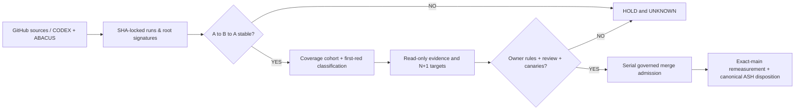

# CODE PURPLE / Evidence-to-Admission Observatory V3

**Mode: evidence-only / read-only.** `MERGE_ADMISSION=HOLD` until a real ruleset and authorized negative/positive canary are verified. This tool cannot approve a PR, merge, waive security, enable remote mutations, close a canonical root, or accept CODEX REX. It does not turn a DAB proposal job into an authenticated Crew launch.

## Deliverables

- `index.html` — standalone live public-metadata HTML, with embedded source-bound snapshot, in-graph native GitHub links, 100% readable zoomed coverage chart and separate callout rows to eliminate arrow/label overlap. Browser button re-fetches public GitHub metadata. Auto-refresh every 15 minutes while the page is open over HTTP(S), with stale coverage explicitly flagged. No browser token.
- `evidence.json` — versioned, pinned observation snapshot. The historical 375-file raw coverage decomposition stays attached to its **original SHA pair**, not relabelled after main advances.
- `census.py` — read-only GitHub REST collector. A→B→A SHA check, 40-character SHA validation, NULL-not-zero for missing, GitHub workflow catalog and exact-main runs; canonical B0 artifact digest, run head and JUnit+coverage JSON required before updated coverage can be accepted as measured. The 300 MB coverage JSON is tail-streamed with a memory cap; no ZIP extraction and no credentials emitted. Source-owned root closure / authenticated CODEX Crew receipts remain NULL.
- `render.py` — deterministic, external-dependency-free renderer. Safe JSON embedding; artifacts may be hosted or opened offline.
- `test_observatory.py` — fake GitHub readback, missing review/issue/count tests, moving-head test, malformed SHA, artifact provenance/digest, null root, renderer safety, lane separation.
- `.github/workflows/code-purple-evidence-observatory.yml` — one read-only 4/day schedule and manual dispatch; no commits, releases, Pages publication or mutation; single concurrency group; native HTML+JSON artifact.

## Native operation

```bash
python -m pytest -q MIP/EVIDENCE_TO_ADMISSION_OBSERVATORY/test_*.py
python MIP/EVIDENCE_TO_ADMISSION_OBSERVATORY/render.py
# Public read-only API may rate-limit without auth. On an owner runner use the
# automatically scoped GITHUB_TOKEN; do not paste tokens into browser HTML.
GITHUB_TOKEN=... python MIP/EVIDENCE_TO_ADMISSION_OBSERVATORY/census.py \
  --out MIP/EVIDENCE_TO_ADMISSION_OBSERVATORY/evidence.latest.json --strict-head
python MIP/EVIDENCE_TO_ADMISSION_OBSERVATORY/render.py \
  --snapshot MIP/EVIDENCE_TO_ADMISSION_OBSERVATORY/evidence.latest.json \
  --output MIP/EVIDENCE_TO_ADMISSION_OBSERVATORY/index.html
```

The scheduled workflow begins only after this source branch is reviewed and merged *under genuinely effective protections*. It publishes an Actions artifact, **not** a protected-main commit. No silent deployment. A user may open the artifact's standalone HTML or authorized publication may deploy the static result separately.

## SHA / graphs / statistical interpretation

Three clocks: `main.sha` (latest GitHub ref), `coverage.measured.sha` (last accepted native B0 receipt), `governance.first_correctly_admitted_pr` (verified acceptance, normally `null`). The historical 66.955→67.345% bar story is from the previous `7488bd7…` PR B0 vs the old `97a8b13…` main. +0.031 percentage points on the fixed 375-file denominator is a *denominator-matched* descriptive increase, not a fully blob-matched causal effect; +0.359pp is compositional. The historic 36.85% main and 36.92% PR broad, 51% diff measurements remain **unmatched**.

- A chart must label `[measurement date, SHA, denominator, cohort]`. Near-ceiling values use an explicitly nonzero zoom axis, not deceptive log scaling of percentages.
- `root_closed` and `root_open` are null until #1929 supplies one accepted canonical root register. GitHub ticket lifecycle or G3CS manifestations cannot replace it.
- For valid statistical stability (e.g. PCA, Bradley–Terry, 6σ), require at least 3 independent comparable observation cycles, fixed eligibility, preregistered baselines and repeatability. A static trend is not a probability of closure.

## N+1 bounded wave and scaling rule

| Lease | May execute concurrently? | Source of truth | Minimum evidence | DoV |
|---|---|---|---|---|
| L-COV | read-only | native B0 current main + historical baseline | exact-SHA scope, file/blob/config denominator, native diff-cover | known paired numerator and denominator; missing remains UNKNOWN |
| L-ROOT | read-only | ABACUS #1929 | three disjoint first-reds and manifestation→root mapping | 1 independent ASH only if reproducible non-recurrence + owner disposition |
| L-CI | read-only | Actions runs/jobs/attempts/artifacts | A→B→A, terminal exact-main B0 Python A10 CodeQL | zero missing required receipts; measure queue p95 only from complete sample |
| L-GOV | **authorized admin only** | ruleset #24494381, ABACUS #1860 | statuses, ≥1 independent review, rejected RED/eligible GREEN canaries | genuinely enforceable admission, no bypass or waiver |
| L-REX | **separately authorized CODEX architecture** | CODEX #977 | authenticated launch principal, path/sha leases, idempotency, accepted return | exact remote launch+REX only if actually executed |

Maximum **three concurrent read-only observation workers**. Source-changing workers require distinct path leases and fresh exact-SHA commits; all merges serialize. N+1 targets are *acceptance criteria*, not an invented probabilistic forecast. A verified CHAR root can graduate to ASH only with negative replays and independent closure, even if the PR merged or a test is green.

## SIPOC / DAG



**Known owner boundaries:** #1860 P0 admission, #1929 canonical root census, CODEX #977 authenticated dispatch. The dashboard does not replace any of these authorities.

## Wave N+1 controller (implemented, evidence-only)

- `wave_history.json` binds *three actual* W007 runs to all 12 native job IDs and uploaded artifact SHA256 digests. Its cohort remains the same two modules and **208 fixed eligible opportunities**; do not mislabel the repeated fixed numeric denominator as proof of byte-identical modules.
- `wave_metrics.py` refuses missing, stale, duplicate, mismatched or incomplete native receipts. It measures N+1 (192/208, 30 tests/cell) -> N+3 (206/208, 61 tests/cell) -> N+4 (208/208, 63 tests/cell). The uncovered opportunity population contracts **16 -> 2 -> 0**.
- Wave normalization accounts for the unequal spans **N+1 to N+3 = 2 wave slots** and **N+3 to N+4 = 1 slot**. The accepted *descriptive* gain rate decelerates as the coverage ceiling is reached; these are not elapsed-time accelerations or stochastic forecasts.
- When the last cohort is saturated, the next slice must move to a **separate, source-bound uncovered module family**, using negative/reverse/fault-injection tests. The next source family must have source+config fingerprint, statements/branches, stable numerator/denominator and native JUnit before any broad-main/diff credit.
- `adaptive_slice_policy` **cannot** authorize source mutation, merge, remote Crew or root closure. It scales from **1 read-only lane** (uncertain current-main evidence) to at most **3 read-only lanes** only on stable same-head B0 and validated coverage artifact; write leases remain DISABLED and one-source-owner-at-a-time. Owner rules and negative RED canary are noncompensating. No near-ceiling tests are added purely to inflate counts.
- CI executes both observatory test suites, publishes `wave.latest.json` with `evidence.latest.json`/HTML, and remains four daily read-only observations (no commit to main). The browser shows historical matched gaps and independently displays latest-main staleness.

```bash
python -m unittest discover -s MIP/EVIDENCE_TO_ADMISSION_OBSERVATORY -p 'test_*.py' -v
python MIP/EVIDENCE_TO_ADMISSION_OBSERVATORY/wave_metrics.py --snapshot MIP/EVIDENCE_TO_ADMISSION_OBSERVATORY/evidence.json --out MIP/EVIDENCE_TO_ADMISSION_OBSERVATORY/wave.latest.json
```

Next pulse DoV: exact current-main B0 coverage JSON and diff-cover under a shared source+configuration; first-red signatures joined to #1929 and independent CHAR to ASH disposition; effective protection readback and negative canary through authorized admin only. **MERGE_ADMISSION=HOLD**.

## Adaptive pacing and competing slice-selection criteria

The next slice is NOT a bigger repetition of W007: its remaining uncovered count
is exactly zero (208/208). The method compares three candidates only where they
have actual source-bound evidence: (A) first-red reappearance risk, (B) newly
uncovered eligible opportunity density per changed file and (C) receipt cost
and runner saturation. Candidate names without eligible/opportunity counts stay
WITHHELD; the controller never substitutes zero. A concrete rank needs a
fingerprinted source SHA, path lease, eligible and uncovered counts; a first-red
case receives priority over a higher-coverage-only case. No overlapping write
leases, no source mutation, merge or REX is authorized by ranking.

N+1 minimum effort = 1 read-only current-main B0 + config/coverage receipt;
N+2 may add a disjoint root-signature observation + matched diff producer;
N+3 may use three read-only observations only if source A->B->A is stable,
B0 terminal and covered, artifacts received and queue p95 <= 900 seconds.
If queue p95 is missing/over limit, cap at one independent observation. The
reported 3.365 -> 0.962 coverage-point gain per wave is a **descriptive
interval-normalized** deceleration, not a runtime speed or probabilistic trend.
No root ASH credit, admission or CODEX remote dispatch can be granted by this
pacing algorithm, even when all technical receipts are green.

## W28: newly measured larger-slice frontier (source candidates, not credited uplift)

The older canonical-main B0 artifact at SHA
`97a8b13faff577272a90edaf0dd4593035e10605` (run 39142444027,
artifact 12142730864) has 52,200 combined eligible opportunities. Three
non-overlapping candidate modules have exactly 508 eligible/374 uncovered:

- `tools/w75_stability_diagnostic.py`: 161 of 221 uncovered.
- `tools/w81_repair_outcome_block.py`: 114 of 162 uncovered.
- `tools/w64_census_reverse_pressure_v2.py`: 99 of 125 uncovered.

The three Git object blobs were verified byte-identical at subsequent main
`9e0200190555736c74295ee74881e3c003e8a35c`, but main moves frequently.
`source_frontier.json` fixes observed SHA, blob and run identities and may not
be relabelled current without a fresh source readback. The bounded *conditional*
contribution to the frozen 52,200-opportunity denominator is 374/52,200 =
**0.7165 percentage points** if every old uncovered opportunity were to be
covered with no regressions; it is **not** a forecast or an accepted global
diff/main uplift. Source churn, altered eligibility and configuration invalidate
the arithmetic extrapolation. The `census.py` observer now rechecks blobs at
its own exact-head source snapshot; missing/changed SHA leaves coverage UNKNOWN.

These 3 modules are scouts, not automatically qualified production priorities.
Only source owners may prove their runtime relevance and license a separate
reviewed testflight. Higher-ranked first-red candidates must keep root and
security evidence segregated; CHAR/ASH transitions require independent closure.

## W29/W30 source-owned implementation: adaptive runner evidence and coverage

- W29 disjoint behavioral source slice is tracked in [draft #2250](https://github.com/GBOGEB/ABACUS/pull/2250), exact initial PR head `38d1d3b52fc7ca943a17471301c20cbe5f5af254`. It tests W75 stability and W64 reverse-pressure behavior without modifying production; focused native [run 39149390636](https://github.com/GBOGEB/ABACUS/actions/runs/39149390636), B0 [39149390719](https://github.com/GBOGEB/ABACUS/actions/runs/39149390719). The two-file historical B0 baseline is **86/346 covered**, **260/346 uncovered**; maximum conditional fixed-52,200 opportunity contribution **0.4981 percentage points**. No current-head uplift credited without same-cohort native B0.
- W30 local observatory negative tests expanded from **56/56 passing (77% combined statement+branch)** to **108/108 passing (90% combined statement+branch)** on local Python 3.13 with pytest-cov. Collector moved **67% to 88%**; renderer **83% to 100%**; queue telemetry **98%**. These are **local** measurements, not native GitHub proof or main coverage.
- New `queue_telemetry.py` requires complete terminal job population, exact SHA/run/attempt, unique job IDs, monotonic timestamps and full pagination before publishing scale-authorizing p95. GitHub REST can report `started_at == created_at` for queued jobs: those must **never** count as zero-second wait samples. Partial terminal samples are labelled diagnostics only.
- Verified historical B0 [run 39142444027](https://github.com/GBOGEB/ABACUS/actions/runs/39142444027) contained 13 terminal jobs with queue p95 **49 s** (nearest rank), execution p95 **427 s**; historical source SHA `97a8b13faff577272a90edaf0dd4593035e10605`. This is *not* the queue p95 of W29; its two jobs were queued at readback, so scale-relevant p95 is UNKNOWN.
- Read-only scheduled workflow remains **four per day**, with no automatic main push. It now runs 108-case native pytest/branch coverage testflight, preserving run-bound JUnit and coverage JSON/XML. Native outcome UNKNOWN until Actions runs on this source SHA after admissible publication.
- Disjoint source ownership: W29 tests W75/W64; W30 modifies only the observatory's collector, template, and its tests. No CODEX Crew launch, accepted REX, root/ASH closure, security waiver, owner-admin rule mutation or inferred approval. `MERGE_ADMISSION=HOLD`.

**Adaptive rule**: with missing current-main B0/artifact or queue p95, remain at **one** observational lane; do not scale from the old 49-second p95. When every current-main B0 job and artifact is exact-head terminal, evaluate p95 ≤900 seconds and noncompensating governance. Expand to at most three disjoint **read-only** scouts; source-writing commits stay with separate owners, independent human review, and serial admission.


## W31/W32 convergence and continuity gate (18 October 2026)

The evidence-only controller `wave_convergence.py` and native pytest `test_wave_convergence.py` are source-bound to this branch. Local independent Python testflight currently **155/155 PASS** and **92% scoped combined statement/branch coverage** across census, renderer, adaptive policy, queue and convergence modules; the 46-case W31 convergence module alone reaches **100%** (101 executable statements, 60 branches). These are **local** metrics, not a GitHub-native, PR-diff or main uplift claim.

`engineering_wave_history.json` preserves two W29 events separately from admitted engineering observations: historical N0 head `38d1d3b52fc7ca943a17471301c20cbe5f5af254` had 128 passing behavioral executions but 2 overall failing jobs and **missing coverage**; N1 head `312042de13212319c0e85c9d012fa43747508e4e` remained QUEUED at last readback. Therefore `observations=[]` is correct: no falsely admitted new W29 wave, no assumed 0% gain, no p95=0.

The convergence gate proves four separate safeguards:
- **Target branch:** 95% for the fixed W75+W64 source-family opportunity cohort (346 historical opportunities), only after a fresh exact-head eligible cohort and coverage config receipt.
- **Plateau:** require **three consecutive N+1=N comparisons** across **four distinct, terminal, source-changing source-slice executions** with disjoint SHA, run ID, artifact digest, and source-slice lease. Re-reading one GitHub run, A→B→A source replay and zero-gain synthetic wave aliases are rejected. Zero means verified identical numerator on a comparable denominator, not missing evidence.
- **Reversals:** newly failing tests/first-reds, A10/security regressions, and lower covered numerator take priority. Queue UNKNOWN or above 900s prevents lane expansion; unmatched files/configurations require explicit rebasing.
- **Scope:** `COHORT_PLATEAU_CONFIRMED` or `SOURCE_TARGET_REACHED` stops spending tests on that **source family** and moves to a separately sourced, measured uncovered cohort. It **never** closes CODE PURPLE, merges a PR, signs REX, authenticates remote Crew or claims deduplicated engineering-root closure. These gates remain separately owner-controlled.

Workflow testflight now covers five observatory modules and includes convergence negative tests. The workflow is not yet merged into protected `main`, and its native success is UNKNOWN. Do not count local tests as admission. Source report/JSON remain read-only artifacts with `MERGE_ADMISSION=HOLD`.

**Next admissible sequence:** acquire repaired W29 [run 39150712686](https://github.com/GBOGEB/ABACUS/actions/runs/39150712686) terminal jobs/JUnit/coverage, exact-head [B0 39150712841](https://github.com/GBOGEB/ABACUS/actions/runs/39150712841), [governance 39150712644](https://github.com/GBOGEB/ABACUS/actions/runs/39150712644), and security. If first-red, repair source on PR #2250 and repeat. Only on terminal and matched numerator+denominator append a genuine wave observation and recalculate the 3-transition hysteresis. Remain at one read-only observation lane while current p95 is UNKNOWN.


## W33 adaptive stop/retrigger — staged, not native-qualified

The isolated, unmerged engineering branch \`code-purple/w33-elastic-stop-retrigger-governor-20261018\` adds \`elastic_wave_governor.py\`, \`test_elastic_wave_governor.py\`, a pinned four-module source scope input and [the W33 lossless handover](W33_ELASTIC_STOP_RETRIGGER_HANDOVER.md). \`wave_metrics.build_wave_receipt\` incorporates its output as a separately labelled *historical focused-source* result, never as current-main B0.

Observed predecessor W31/W32 exact-head native run [39159837402](https://github.com/GBOGEB/ABACUS/actions/runs/39159837402): 236/236 test executions passed; the W75/W64/W81/W82 four-module coverage scope is **660/723**. Local >=95% coverage expansion stops for W75, W64 and W81; W82 is **164/215**, requiring **+41** newly covered matched opportunities to reach 95%. The existing two-cell workflow has been extended *on the W33 candidate branch* to include canonical W82 tests and W33 governor oracles without creating a new workflow. **No W33 native run or accepted uplift is claimed.**

The W33 controller implements evidence-bound scaling 1->2->4->8 on two fresh source-changing comparable positive transitions, complete exact-run queue clocks and 100% artifact yield. It throttles under queue p95 >900 seconds or evidence defects and limits UNKNOWN telemetry to one read-only lane and zero native runner proposals. Local target/plateau stops do not stop the programme. An actual new first-red, source frontier, comparable regression or contract change may idempotently re-enter a *single* pilot; repeated polls never scale. Artifact families (JUnit, coverage JSON/XML, manifest) have separate native and downstream-consumer denominators.

**Governance HOLD:** effective ABACUS ruleset was observed with zero mandatory approving reviews and no mandatory status checks. PRs #2250/#2273 merged without submitted approvals, and #2273 merged before its Python 3.12 job became terminal. W33 is therefore branch-only until authorized owner repairs protection, exact required checks and RED negative canary. See [#2087](https://github.com/GBOGEB/ABACUS/issues/2087). \`MERGE_ADMISSION=HOLD\`; no new global CONTROL, Six Sigma or root/REX acceptance.

## W34/W35 terminal local-stop checkpoint (18 Oct 2026)

After the W33 staged controller, the explicitly bounded single-cell branch testflight [run 39161484760](https://github.com/GBOGEB/ABACUS/actions/runs/39161484760) found one implementation root (artifact count shadowed artifact-census object), producing three failed tests. Source-owner correction at `c51e6b9d112fb9a4e5fecd55189f94680b832503` passed [run 39161560713](https://github.com/GBOGEB/ABACUS/actions/runs/39161560713) 201/201 cases, focused four-module 697/723. W35 two CLI negative/canonical cases at tested head `6f51404c121283c56c92cfbabd064f0e63815883` passed [run 39161760486](https://github.com/GBOGEB/ABACUS/actions/runs/39161760486) 203/203, four-source **707/723 (97.79%)**; W82 **211/215 (98.14%)**, plus +47 vs W31 W82 164/215. Thus W75 219/221, W64 123/125, W81 154/162, W82 211/215 are **4/4 >=95% local target** and broad same-slice test expansion STOPS.

`w33_verified_focused_input.json` now pins this W35 terminal source head (not current main), exact run identity, artifact ZIP hash, four native artifact-file families and 203 true test cases. The observatory's controller should return `next_pilot=null`, 4 local coverage CONTROL decisions, 1 read-only observation lane and 0 native scale proposals while A->B->A main/head and complete queue p95 remain UNKNOWN. Global CONTROL/REX/accepted-root/merger admissions remain HOLD. A material new failed source path or scoped regression alone reopens a *single* targeted pilot. Separate governance-only W36 branch `code-purple/w36-governance-seven-workflow-census-20261018` addresses 7/198 otherwise unclassified workflow definitions; its native report and inherited first-reds remain independent.

The four-source 707/723 measurement is focused, not canonical ABACUS main coverage; 1-cell W35 evidence is not retrospective 2-cell current-head acceptance.
