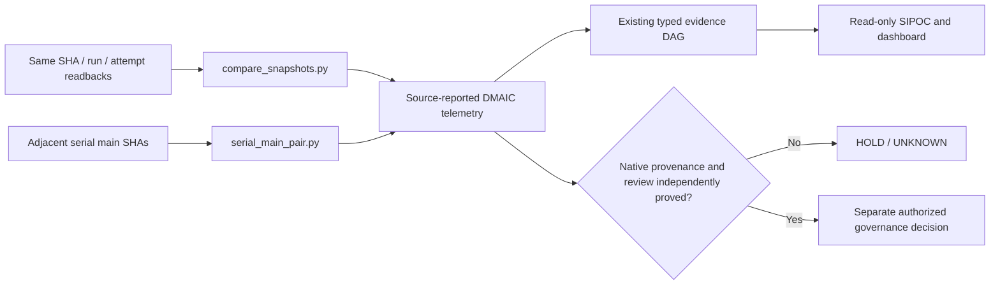

# CODE PURPLE · G3C-S Convergence Observatory v2

Read-only **adapter** for the existing ABACUS MIP / DMAIC / EVERRED / MYCELIUM authorities. This package is not a new canonical acceptance ledger. Its one frozen, hashable source observation generates a compact HTML dashboard, two readable SVGs, typed DAG, SIPOC, metrics JSON, DOT graphs and QA receipt. It **cannot** enable CI, approve code, merge a PR, close causal roots, launch a Crew worker, waive security, or infer QPS engineering compliance.

## Exact observed reference

- Current-main readback (18 October 2026): `585dd7476d3b3c629f864c37ec7d7526a648b4c0` (**not** a claim that main remains at this SHA).
- Parallel source PRs: ABACUS [#2217](https://github.com/GBOGEB/ABACUS/pull/2217), [#2219](https://github.com/GBOGEB/ABACUS/pull/2219) and [#2220](https://github.com/GBOGEB/ABACUS/pull/2220), merged chronologically S1 → S3 → S2, but **sampled CI outcomes are parallel**.
- Evidence: native W70 and DAB ZIP-member hashes, latest available 20/21/21 GitHub PR-head workflow run identities and ruleset [24494381](https://github.com/GBOGEB/ABACUS/rules/24494381).
- Snapshot: **46/62 selected PR-head workflows successful, 16 nonterminal**. W70 focused lines **133/133**; branches **17/18**. W70 manifestations **45 CLOSED + 31 OPEN = 76**, not deduplicated roots. Historical main combined **34,222/51,264**, **not** matched new-main coverage.
- Admission `HOLD`: active ruleset has zero required approvals, no required CI statuses, and no demonstrated negative RED canary. All three ordinary merges had zero eligible approving reviews.

## Rebuild offline

From this folder, with Python 3.9+ and Graphviz `dot` installed:

```bash
python tools/converge.py --input source/G3CS_CONVERGENCE_INPUT.json --out output
python -m unittest discover -s tests -p 'test_*.py' -v
python tools/qa_html.py  # Playwright + Chromium; optional but required for visual release QA
```

`output/G3CS_CONVERGENCE_DASHBOARD.html` is single-file portable HTML (embedded SVG diagrams). `output/*DAG.json` and `output/*SIPOC.json` are machine-readable typed views. SVG/DOT files can be reused in decks/reviews. The semantic source SHA-256 and generated hashes appear in `output/QA_RECEIPT.json`. No network dependency is needed to rebuild the existing observation.

## Regenerate the frozen input from six native ZIPs

If you have independently fetched the six workflow artifacts:

```bash
python source/build_snapshot.py --artifact-dir /path/to/artifact_zips --out source/G3CS_CONVERGENCE_INPUT.json
```

This reproduces **that frozen 2026-10-18 observation**, not a live API poll. Native zipped members and SHA256 digests are mandatory input evidence. The committed JSON remains the portable re-render source even when ZIP archives are not available. Compare archive digests before promoting any new snapshot; do not replace a frozen observation with a later one silently.

## Single evidence model: five noncompensating dimensions

| Plane | Unit / denominator | Valid progress | Cannot prove |
|---|---|---|---|
| 1. Delivery & native telemetry | Unique `(repository, source_sha, run_id, attempt)` and child job IDs | Terminal job/run progress, measured queue and execution p95 with time provenance | Causal-root closure or admission |
| 2. Engineering quality | Same source selection + scanner version + rules + paths / roots | Attributed scanner first-red removal, negative/reverse tests | Main coverage or a governed merge |
| 3. Coverage & penetration | Covered/eligible **for the same selection/config/tool** | Comparable statement/branch or changed-line numerator gain | Coverage from a green testflight or differing denominators |
| 4. BD/root register | Unique causal fingerprint with accepted owner disposition and no comparable reproduction | Root state `OPEN -> ASH_QUALIFIED` with independent receipts | Root closure from ordinary issue status or PR merge |
| 5. P0 governance & release | Exact PR head and protected merged-main SHA | Required statuses enforced; eligible review; RED canary blocked; replay success | Approval from documentation or local tests |

`UNKNOWN` is encoded as JSON `null`, **never as 0**. A completed-success fraction is separate from successful/observed fraction. Job-red lower bounds override a superficially green workflow cohort. A source-mutating worker may not be launched from this read-only projection.

## Typed dependency DAG and SIPOC

The typed DAG has distinct nodes for native source, normalization, **parallel PR-head clock**, **serial merged-main clock**, per-family measurements, candidate root graph, DMAIC roll-up, authorized review/gate, post-merge verification and CODEX/QPS consumers. Edges are tagged `INPUT`, `FINGERPRINTS_NOT_CLOSURES`, `MERGED_EVENT_NOT_ADMISSION`, `REQUIRES`, etc. Cycles and broken nodes fail closed. The SVG is a presentation of the full typed JSON, not separate authority. SIPOC has five rows with exact suppliers/inputs/processes/outputs/consumers and `authority_transfer=false`.

Do not write another workflow-governance policy or generated inventory: PR [#2144](https://github.com/GBOGEB/ABACUS/pull/2144) owns that source. The existing acceptance provider (`tools/everred_v3/acceptance/graph.py`, `telemetry.py`), MIP CI temporal provider (`tools/mip_ci_temporal_rollup.py`) and coverage comparator (`scripts/cbd_matched_coverage_delta.py`) remain the reference implementations. This folder is an additive adapter/projection.

## DMAIC / mathematics / forecast limits

**Define:** owner, P0, unique scope and invariant denominator. **Measure:** exact native snapshots with source/run/job/attempt identity. **Analyze:** lineage and root graph, causal candidates separate from dependencies; compare selected same-population observations. **Improve:** disjoint repairs with negative, fault-injection, A→B→A and reverse tests; never suppress required gates. **Control:** independent review, negative merge canary, current-main recertification and owner-signed REX acceptance.

For stable/unstable/converging/diverging decisions, at least three **serial comparable main** samples are needed even for descriptive second differences. Formal control limits or predictive intervals additionally require suitable independent/weakly dependent runs (often 20+ per stable cohort), consistent scope, dispersion estimates and prespecified decision rules. Three parallel PR-head observations provide no causal time slope, PCA loading stability, BT ranking, Six Sigma sigma-level or asymptote proof.

The displayed `46..62` N+1 bound is only the arithmetic minimum/maximum for a **fixed set of 62 observed run IDs**, not a probabilistic forecast. For a genuine N+2 rolling forecast, register a target clock, frozen selection/hash, expected value or interval and independent assumptions *before* seeing the outcome, then score error without rewriting the forecast.

## Next admissible operational wave

1. Resolve existing workflow/job reds at exact current heads; re-pull all terminal job-level and native artifact evidence, never confuse queued runner work with zero failure.
2. Collect a **paired, same-unit** before/after census on merged main: Flake8 and Ruff by fingerprint, B0 full JUnit and coverage, diff selection/config; compare previous and new denominators and tool versions.
3. Administrator restores effective main required contexts, at least one eligible independent approving review, last-push/thread protections and a rejected RED canary. Report actual enforced ruleset, not proposed config.
4. Independently accept causally distinct roots by source-owner and reviewer, not by issue-close totals; preserve confidentiality and Safety gates.
5. Perform one serial admission, exact PR-head CI, merge-main CI, matched main/diff coverage, and REX; then issue the next N+1 snapshot. Until then `MERGE_ADMISSION=HOLD`.


## Serial merged-main measurement extension (G3C-S W5)

The existing `tools/compare_snapshots.py` compares **successive readbacks of the
same exact (source SHA, run ID, attempt) population**. It must never be used
to infer longitudinal improvement between different PR heads.

The additional `tools/serial_main_pair.py` compares **two consecutive,
source-reported merged-main commits** with different native run/job IDs but the
same frozen logical job cohorts. Its input schema is
`codepurple.g3cs.serial-main-pair-input.v1`. Capture real main SHA, explicit
parent-main SHA, timezone-aware capture time, SHA-bound job/run/attempt IDs,
first-red fingerprints and owner root statuses. Coverage
`statement`/`branch`/`diff` entries can be `null`; otherwise each must
contain source SHA, covered/eligible counts, and SHA256 hashes for scope,
selection and tool. **The comparator rejects any noncontiguous main chain.**

Example invocation (on separately obtained, source-reported JSON observations):

```bash
python tools/serial_main_pair.py \
  --input /path/to/two-serial-main-observations.json \
  --output /tmp/g3cs-serial-main-pair.json
python -m unittest discover -s ../../tests -p 'test_g3cs_serial_main.py' -v
```

Interpretation rules:

- Comparisons return `PAIRED_SOURCE_REPORTED` only when the scope, tool,
  selection and denominator all match; otherwise `UNKNOWN` or
  `NONCOMPARABLE`. No inferred coverage from green workflow checks.
- A first-red that disappears is a **nonreproduced candidate**, not an
  accepted causal-root closure. A source-reported `CLOSURE_CLAIMED` root
  is not independently verified.
- Queue and execution p95 require at least five **matched terminal jobs with the same environment SHA256**
  with distinct, plausible run/job/attempt IDs and valid timing clocks.
  Skipped, cancelled and nonterminal jobs do not fabricate durations. The same-run comparator rejects changed terminal outcomes on immutable job/run identities, including impossible failure→success claims on a single attempt.
- Two serial observations allow descriptive differences only: stability,
  PCA, Bradley–Terry, Six Sigma and predictive intervals remain `null`.
  The result labels source evidence
  `SOURCE_REPORTED_NOT_INDEPENDENTLY_VERIFIED`, with
  `admission=HOLD` and `authority_transfer=false`.
- Typed output `dag_joins` references the existing graph nodes
  `main/matrix/coverage/roots/dmaic/dashboard`; `sipoc_process` is the
  existing MIP/gg_MATH matched-cohort family. This is not a new SSOT,
  workflow policy, Crew launcher or merge-authority provider.

The new repository-native `tests/test_g3cs_serial_main.py` contains
**19 positive/adversarial methods**, including forged timestamps, duplicate
job identities, missing source SHA, unmatched denominators, premature
observations, negative clocks and unsupported authority promotion. Local
unit proof passed 19/19; current PR-head native CI and independent review
remain separate.

Browser QA now creates the untracked `qa/` folder in clean clones,
checks the dashboard's embedded source digest against the source input, and
emits SHA256 hashes of HTML and three viewport screenshots. A local browser
receipt is not an exact-head native release receipt.

### Comparison-provider DAG / SIPOC crosswalk

The diagrams and five SIPOC rows generated by `tools/converge.py` remain
the published frozen-source projection. The two comparison tools join its
existing `main`, `matrix`, `coverage`, `roots`, `dmaic` and `dashboard` atoms:



The serial comparator belongs to the existing SIPOC *MIP / gg_MATH*
measurement row. It neither grants approval nor changes canonical DAG
or SIPOC machine-readable JSON until a new governed source observation
is provided and the projection is regenerated and QA-verified.

## Artifact QA status

- Existing structural/typed metric validation: **35 previously locally exercised** tests, plus four new same-attempt immutability denial tests; **19 new serial-main denial/positive tests passed locally**. Exact PR-head native qualification still pending.
- Desktop/laptop/mobile Playwright: **PASS** (1440×1000, 1280×800, 390×844), no console/page error, no broken SVG image, no horizontal overflow; native filter/search interaction verified.
- Presentation assets are generated from the same input SHA; `qa/browser_receipt.json` and PNG captures are generated on demand (not silently assumed available in a clean clone). Their hashes are retained when produced.
- Evidence level: `LOCAL_REPRODUCIBILITY`. This is **not** an exact-head native GitHub CI receipt or accepted release.

## Repeatable N→N+1 native telemetry comparison (v2 extension)

The new `tools/compare_snapshots.py` accepts two **immutable read-only native run+job JSON snapshots**, requires matching `(repository, source_sha, run_id, attempt, selection_sha256, source_clock)` populations, and reports exact blocked→success and success→regression transitions. It refuses to calculate a numeric delta if the run selection changes, timestamps are nonmonotone, or the source/config identity differs. This prevents W1/W2/W3 parallel successes from masquerading as temporal improvement.

```bash
python tools/compare_snapshots.py --before /path/to/native_N.json --after /path/to/native_N1.json --out /tmp/g3cs-native-delta.json
python -m unittest discover -s tests -p 'test_*.py' -v
```

The input contract `codepurple.g3cs.native-run-snapshot.v1` requires `source_sha`, `selection_sha256` (SHA256 of frozen workflow/run selection contract), `observed_at_utc`, `source_clock` (`EXACT_PR_HEAD` or `CURRENT_MAIN`), a run array with `run_id`, `attempt`, `status`, `conclusion`, `source_sha`, and optionally child jobs containing `job_id`, `status`, `conclusion`, `source_sha`, `created_at`, `started_at`, and `completed_at` in UTC `Z` form. A missing `created_at` is **not** backfilled with a workflow timestamp under an unlabeled queue metric. `queue_sample_n` and `runtime_sample_n` expose the actual denominator; p50/p95 are descriptive even with small n and never establish statistical control. A cleared job first-red **does not close a causal engineering root** without independent accepted disposition.

Repo-native bridges: `tests/test_g3cs_convergence.py` and `tests/test_g3cs_native_snapshots.py` explicitly expose the provider's **35** cases to ABACUS's existing `pytest.ini` collection. They introduce no new GitHub Actions workflow, workflow-policy owner, or CI bypass.
