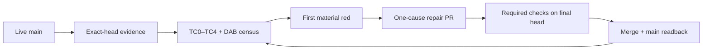
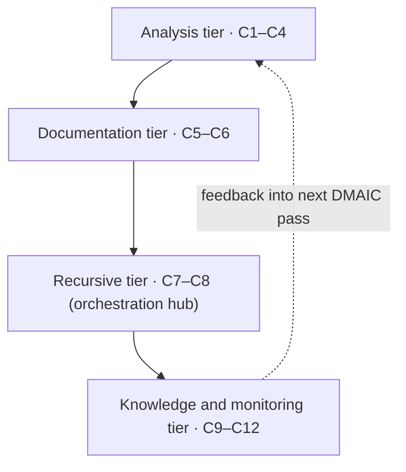

# ABACUS — DOW analytical runtime, first-red diagnosis and CI

<!-- markdownlint-disable MD001 MD013 MD022 MD029 MD031 MD032 MD033 MD040 MD060 -->

[](pyproject.toml)
[](https://github.com/GBOGEB/ABACUS/releases/latest)
[](https://github.com/GBOGEB/ABACUS/actions/workflows/ci-enhanced.yml)
[](.python-version)
[](https://gbogeb.github.io/ABACUS/)
[](LICENSE)

> **ABACUS runs the 12-cluster DMAIC analysis of cryogenic engineering data, and is where federation CI goes red-to-green at source: diagnose the first real failure, repair it, prove it on the exact head.**

## At a glance

| | |
|---|---|
| **Domain** | Multi-agent DMAIC analysis of cryogenic engineering data and documents (the DOW runtime) on the 12-cluster contract, plus first-red diagnosis, source-level CI repair and independent security for the federation |
| **EPICs carried here** | **CODE PURPLE** evidence and coverage ([#2720](https://github.com/GBOGEB/ABACUS/issues/2720), [#2326](https://github.com/GBOGEB/ABACUS/issues/2326), [#1944](https://github.com/GBOGEB/ABACUS/issues/1944)) · **DAB** static-analysis burn-down ([#1609](https://github.com/GBOGEB/ABACUS/issues/1609), [#1866](https://github.com/GBOGEB/ABACUS/issues/1866)–[#1868](https://github.com/GBOGEB/ABACUS/issues/1868)) · **U-series** CI hardening ([#2669](https://github.com/GBOGEB/ABACUS/issues/2669), [#2721](https://github.com/GBOGEB/ABACUS/issues/2721), [#2722](https://github.com/GBOGEB/ABACUS/issues/2722)) · **GOV-001** QPS cost roundtrip ([#633](https://github.com/GBOGEB/ABACUS/issues/633)) · **QPS DOW coverage** ([#785](https://github.com/GBOGEB/ABACUS/issues/785)) |
| **Owner and decision authority** | Repository owner **GBOGEB** ([CODEOWNERS](.github/CODEOWNERS)): admission to `main`, releases and every external grant. No agent, bot or CI verdict holds this authority. |
| **Role in the federation** | The *runtime and repair shop*: it executes the DMAIC analysis and fixes red CI where it starts; it does not own QPS engineering acceptance or federation governance. |
| **Owns** | `DMAIC_V3` runtime and the `abacus` CLI, the 12-cluster orchestrator, DOW/KEB bridges, the CI census and ratchets (TC0–TC4, DAB, Bandit, A10 guard), the `docs/` Pages site |
| **Does not own** | QPS engineering SSOT, OCD/ADR and release identity (cryoplant-project) · semantic provenance, federation contracts and the canonical Bradley–Terry/PCA engine (CODEX) · Kahn scheduling and the JADE census (Hub) · numerical method ownership (gg_MATH) |
| **Status snapshot** | `main@da5b6b7`, read 15 November 2026 — 50 open issues, 16 open PRs. [Details and closure proofs ↓](#6-status-and-open-gates) |

**New here?** Read [§1](#1-why-abacus-exists--bios) (2 min), then the route that matches you:

| I want to… | Open this first |
|---|---|
| Understand purpose, ownership and flow | [BIOS](#1-why-abacus-exists--bios) and [from source to decision](#2-from-source-to-decision) |
| Find the code for a cluster or DMAIC phase | [What is inside](#3-what-is-inside) |
| Browse the rendered docs and dashboards | [Documentation site](https://gbogeb.github.io/ABACUS/) and the [repository map page](docs/repo-structure/index.html) (finds files that used to sit at the root) |
| Run the tests myself rather than trust CI badges | [Run it locally](#7-run-it-locally) |
| Know what is red, open, or next | [Status and open gates](#6-status-and-open-gates) |
| Add or change a workflow | [Workflow rationalization](docs/ci/WORKFLOW_RATIONALIZATION.md) and [workflow policy](ci/governance/workflow_policy.json) |
| Read the release history (v2.2 → v4.4.0) | [Historical lineage](#historical-lineage) |

## 1. Why ABACUS exists — BIOS

**B — Baseline.** `pyproject.toml` `[project].version` is the release identity: `main` declares **v5.0.0**, and the last published release is **v4.4.0** (18 May 2026). The 12-cluster contract is the architecture baseline; everything else is lineage.

**I — Identity and integrity.** A status claim names the `main` SHA it was read at. Release-era figures (v4.4.0's 95 % completion, 92.1 quality score, 90 % coverage) stay bound to that release and are never quoted as current-main health. New and changed files pass the A10 confidentiality guard before they land.

**O — Orchestration with ownership.** One canonical orchestrator, [`DMAIC_V3/core/twelve_cluster_orchestrator.py`](DMAIC_V3/core/twelve_cluster_orchestrator.py), drives DMAIC phases 1–8 across the twelve clusters. Wave claims in [`.waves/WAVE_CLAIMS.yaml`](.waves/WAVE_CLAIMS.yaml) are rolled up by CODEX; the JADE pointer [`.jade/repo.yaml`](.jade/repo.yaml) names where each repository fact lives.

**S — Safety and source-qualified status.** `UNKNOWN` is not `PASS` or zero. A test stage that collects nothing is a failure. Coverage, false-green and lint ratchets are never relaxed to turn a check green.

**Who uses it:**

| Reader | Comes for | Leaves with |
|---|---|---|
| External visitor | What ABACUS is and how it is governed | This page, the [docs site](https://gbogeb.github.io/ABACUS/), live [issues](https://github.com/GBOGEB/ABACUS/issues) |
| Engineer / analyst | Run or extend the DMAIC analysis | A feature branch, native tests, a PR |
| CI repair agent | The next measured red to fix | One root cause per PR, exact-head proof |
| Federation peer (CODEX, Hub, cryoplant) | Runtime support receipts and QA | A pinned ABACUS SHA and its evidence |
| Owner | Decide admission | A PR whose required checks are green on the final head |

**Where authority lives:** [`pyproject.toml`](pyproject.toml) (release identity) · [`.jade/repo.yaml`](.jade/repo.yaml) (repo pointer) · [`ci/governance/workflow_policy.json`](ci/governance/workflow_policy.json) and [`docs/ci/WORKFLOW_RATIONALIZATION.md`](docs/ci/WORKFLOW_RATIONALIZATION.md) (which workflows are live) · [`governance/release_policy.yaml`](governance/release_policy.yaml) and [`governance/branching_model.yaml`](governance/branching_model.yaml) · [`.waves/WAVE_CLAIMS.yaml`](.waves/WAVE_CLAIMS.yaml).

## 2. From source to decision

Every change, CI repair or status update follows the same loop:

1. **Refresh live `main`** and read the open and recently merged PR state.
2. **Recover exact-head evidence** for the commit in question: tests, checks, coverage.
3. **Re-census** (TC0–TC4 completeness plus the DAB residual) so work is chosen from measurement, not memory.
4. **Repair the first material repo-local red only** — one root cause per PR.
5. **Keep the ratchets**: test count, coverage, false-green and lint baselines may only improve.
6. **Prove on the final head**: the required checks on `main` (§6) must pass on the PR's last commit.
7. **Merge, read back `main`**, and re-census before promoting the next residual.

## 3. What is inside

| Block | Native source | Input → output | Boundary |
|---|---|---|---|
| Canonical orchestrator | [`DMAIC_V3/core/twelve_cluster_orchestrator.py`](DMAIC_V3/core/twelve_cluster_orchestrator.py), wrapper [`local_mcp/agent_orchestrator_v3.0.py`](local_mcp/agent_orchestrator_v3.0.py) | Repository and document inputs → phase-by-phase DMAIC run with temporal hooks | Orchestration evidence, not engineering acceptance |
| DMAIC phases 1–8 | [`DMAIC_V3/phases/`](DMAIC_V3/phases/) | Intake → metrics → root cause → improvement → control → knowledge → actions → TODO | Each phase's output is input to the next, not a release claim |
| CLI | [`DMAIC_V3/__main__.py`](DMAIC_V3/__main__.py) (`abacus` entry point in `pyproject.toml`) | Command line → orchestrated run | — |
| E6 knowledge layer | [`phase6_knowledge.py`](DMAIC_V3/phases/phase6_knowledge.py), [`temporal_metadata_engine.py`](DMAIC_V3/core/temporal_metadata_engine.py), [`handover_bridge.py`](DMAIC_V3/core/handover_bridge.py) | Phase outputs → versioned knowledge references and handover state | Handover documents are views of execution state |
| Tuple metadata | [`src/dmaic/tuple_metadata.py`](src/dmaic/tuple_metadata.py), [`scripts/validate_tuple_metadata.py`](scripts/validate_tuple_metadata.py) | Tuple entries → validated bridge keys and status | Schema validity ≠ content truth |
| CI governance and ratchets | [`ci/governance/workflow_policy.json`](ci/governance/workflow_policy.json), [`tools/a10_guard.py`](tools/a10_guard.py), [`scripts/dab_formatter_lane.py`](scripts/dab_formatter_lane.py), [`governance/dab/`](governance/dab/) | Workflows, findings, diffs → classified census and fail-closed gates | A green census row is not a release |
| Docs site and HTML exports | [`docs/`](docs/README.md), [`scripts/generate_docs_html.py`](scripts/generate_docs_html.py), [`deploy-docs.yml`](.github/workflows/deploy-docs.yml) | Markdown and data → Pages dashboards | Rendered pages are not source authority |
| Federation and waves | [`federation/`](federation/), [`MIP/`](MIP/README.md), [`.waves/`](.waves/README.md) | Peer receipts and wave claims → roll-up inputs for CODEX | No transfer of another repo's ownership |

### 12-cluster map

| Cluster | Phase | Responsibility | Entry point |
|---|---|---|---|
| C1–C2 | 1 Define | Discovery and intake | `DMAIC_V3/phases/phase1_define.py` |
| C3–C4 | 2 Measure | Static metrics and baselines | `DMAIC_V3/phases/phase2_measure.py` |
| C5–C6 | 3–4 Analyze / Improve | Root cause and implementation changes | `phase3_analyze.py`, `phase4_improve.py` |
| C7–C8 | 5–6 Control / Knowledge | Quality control and orchestration hub | `phase5_control.py`, `phase6_knowledge.py`, `core/twelve_cluster_orchestrator.py` |
| C9–C10 | 7 Action tracking | KEB / GBOGEB runtime operations | `phase7_action_tracking.py`, `local_mcp/knowledge_integration_v2.3.py` |
| C11–C12 | 8 TODO + temporal monitoring | Temporal hooks and task governance | `phase8_todo_management.py` |

Architecture reading: [12-cluster vision](12_cluster_vision.md) · [tool ecosystem map](tool_ecosystem_map.md) · [bridges and connections](docs/BRIDGES_AND_CONNECTIONS.md).

## 4. Where ABACUS sits in the federation

ABACUS links to these repositories; it does not re-implement them.

| Repository | Keeps authority for | ABACUS interface |
|---|---|---|
| [pipeline-automation-hub](https://github.com/GBOGEB/pipeline-automation-hub) (`master`) | Mission Control, Kahn scheduling, JADE census, merge-governance evidence | Census and readiness inputs; reusable workflows |
| [CODEX](https://github.com/GBOGEB/CODEX) | Semantic provenance, federation contracts, MIP kit, Pages governance, canonical `pca_engine` | Wave-claims roll-up; MIP kit pin; metrics schema shared with [`docs/api/dmaic_metrics.json`](docs/api/dmaic_metrics.json) |
| [cryoplant-project](https://github.com/GBOGEB/cryoplant-project) (private) | QPS engineering SSOT, OCD/ADR, release identity | Exact-pin runtime support receipts (validation support only) |
| [gg_MATH](https://github.com/GBOGEB/gg_MATH) | Numerical kernels and uncertainty methods | Method source |
| [GEMINI](https://github.com/GBOGEB/GEMINI) | Cross-agent handover contracts | Ecosystem dispatch target |

Cross-repo hub map and public/private boundary: [`docs/integration/CROSS_REPO_MAP.md`](docs/integration/CROSS_REPO_MAP.md). Last cross-repo integration pass (25 Oct 2026): [`docs/INTEGRATION_REPORT.md`](docs/INTEGRATION_REPORT.md).

## 5. Process diagrams

Declared architecture, not an execution receipt.





## 6. Status and open gates

**Snapshot: `main@da5b6b7`, read 15 November 2026.** Rows point at live owners; open the link for the current position.

| Gate | Status | What would close it |
|---|---|---|
| Release identity | `main` declares **v5.0.0**; last published release **v4.4.0** (18 May 2026). No v5 tag yet. | A tagged release cut from an admitted `main` SHA under [`release_policy.yaml`](governance/release_policy.yaml) |
| `main` protection | **Ruleset active**: pull request required; required checks *Python proof completeness*, *ABACUS compatibility gate*, *CodeQL*, *osv-scanner*. **0 required approvals**, so independent review is not enforced. | Owner decision on review requirements, read back from the ruleset |
| Merge admission | [#1860](https://github.com/GBOGEB/ABACUS/issues/1860) admission **HOLD** with a resume queue | Exact-head findings dispositioned, manual review recorded |
| Flaky test leg | [#2669](https://github.com/GBOGEB/ABACUS/issues/2669) coverage `DataError` under `-n auto --cov` | Deterministic coverage combine under xdist |
| Workflow fan-in | [#2722](https://github.com/GBOGEB/ABACUS/issues/2722) PR Feedback Gate Evaluator triggered by 15 workflows | Fan-in collapsed; superseded-run cancellation already merged in [#2741](https://github.com/GBOGEB/ABACUS/pull/2741) |
| Collection gaps | [#2721](https://github.com/GBOGEB/ABACUS/issues/2721) deselected tests; [#2733](https://github.com/GBOGEB/ABACUS/pull/2733) open | Each deselection collected or skipped with a recorded reason |
| Dashboard deploy | [#2728](https://github.com/GBOGEB/ABACUS/issues/2728) gh-pages 403; [#2758](https://github.com/GBOGEB/ABACUS/pull/2758) removes the dead job | PR merged; Pages stays workflow-built |
| Formatter burn-down | Black lanes **W00–W02 of 4** merged 15 Nov ([#2747](https://github.com/GBOGEB/ABACUS/pull/2747), [#2748](https://github.com/GBOGEB/ABACUS/pull/2748), [#2750](https://github.com/GBOGEB/ABACUS/pull/2750)); Bandit ratchet key fix [#2740](https://github.com/GBOGEB/ABACUS/pull/2740) open | Lane W03 merged; ratchet keyed wrap-insensitively ([#2712](https://github.com/GBOGEB/ABACUS/issues/2712)) |
| Workflow estate | 224 workflow YAML files under `.github/workflows/` at this snapshot; which ones are live is decided by policy, not by count | [Workflow policy](ci/governance/workflow_policy.json) and [rationalization](docs/ci/WORKFLOW_RATIONALIZATION.md) kept current |

**Live metrics** (self-updating, read from [`docs/api/dmaic_metrics.json`](docs/api/dmaic_metrics.json) on `main`):

[](docs/api/dmaic_metrics.json)
[](docs/api/dmaic_metrics.json)
[](docs/api/dmaic_metrics.json)
[](docs/api/dmaic_metrics.json)
[](docs/api/dmaic_metrics.json)

## 7. Run it locally

PR checks run on **Python 3.14** ([`.python-version`](.python-version), *Enhanced CI*, *smoke-test*, *a10-guard*); `pyproject.toml` declares `>=3.11`. Test on 3.14 before calling a change verified.

```bash
git clone https://github.com/GBOGEB/ABACUS.git
cd ABACUS
python -m pip install -r requirements.txt -r requirements-test.txt
python -m pip install -e .
make test                      # pytest DMAIC_V3/tests -q
python -m pytest -q            # testpaths from pytest.ini: tests, DMAIC_V3/tests
python tools/a10_guard.py --help
```

Local runs are a development path, not native CI. Exact-head evidence lives in [Actions](https://github.com/GBOGEB/ABACUS/actions) on the PR's final commit.

## 8. Evidence rules and non-compensation

- Source → validator → exact-head execution → owner admission → derived view. A later step never stands in for an earlier one.
- `UNKNOWN` is not `PASS` or zero; zero collected tests is a failure.
- Historical release figures are bound to their release; current-main health comes from the live census and Actions.
- Raw debt counts are kept next to classified counts; classification never erases the raw number.
- Runtime support to QPS is validation support only: it transfers no engineering, procurement or acceptance authority.
- Deferred reviews follow [`ABACUS_DEFERRED_REVIEW_POLICY.md`](governance/ABACUS_DEFERRED_REVIEW_POLICY.md). Report vulnerabilities via [`SECURITY.md`](SECURITY.md).

## 9. Repository map and next actions

| Source | Why open it |
|---|---|
| [`DMAIC_V3/`](DMAIC_V3/) | Runtime package: core, phases, tests |
| [`src/`](src/), [`tools/`](tools/), [`scripts/`](scripts/) | Libraries, guards, CI and analysis scripts |
| [`tests/`](tests/) | Repository-level tests (plus `DMAIC_V3/tests`) |
| [`ci/`](ci/), [`governance/`](governance/) | Workflow policy, ratchet baselines, release and branching policy |
| [`docs/`](docs/README.md) | Pages site source, CI docs, integration reports |
| [`docs/repo-structure/`](docs/repo-structure/ROOT_REFACTOR_PLAN.md) | Root refactor plan and the map of moved root files |
| [`federation/`](federation/), [`MIP/`](MIP/README.md), [`.waves/`](.waves/README.md) | Federation inputs, MIP rollout, wave claims |
| [`CODE_MAROON/`](CODE_MAROON/README.md) | Security check-and-fix programme notes |
| [`docs_versioned/`](docs_versioned/handover/MASTER_HANDOVER_INDEX.md) | Versioned handover and release-era documentation |
| [Issues](https://github.com/GBOGEB/ABACUS/issues), [pull requests](https://github.com/GBOGEB/ABACUS/pulls), [Actions](https://github.com/GBOGEB/ABACUS/actions) | Live queue, PR heads and CI evidence |

**Next governed actions, in order:**

1. Land the open repair PRs one cause at a time: [#2758](https://github.com/GBOGEB/ABACUS/pull/2758) (dead deploy job), [#2740](https://github.com/GBOGEB/ABACUS/pull/2740) (Bandit key), [#2733](https://github.com/GBOGEB/ABACUS/pull/2733) (staging skip reason).
2. Fix the flaky coverage leg ([#2669](https://github.com/GBOGEB/ABACUS/issues/2669)) so required checks stop needing reruns.
3. Collapse the PR Feedback Gate fan-in ([#2722](https://github.com/GBOGEB/ABACUS/issues/2722)).
4. Finish the formatter lanes (W03) and keep the flake8/Bandit ratchets moving down.
5. Owner: decide whether `main` requires an independent approval, then read the ruleset back.
6. Re-cut this status snapshot at the new `main` SHA when any of these moves.

### Historical lineage

<details>
<summary>Release-era records (v2.2 → v4.4.0) and superseded status pointers</summary>

These records are kept for traceability. They describe the state at their own date, not current `main`.

| Record | What it was |
|---|---|
| [v4.4.0 release notes](https://github.com/GBOGEB/ABACUS/releases/tag/v4.4.0), [announcement](ANNOUNCEMENT_v4.4.0.md), [final status dashboard](docs/final_status_v4.4.0.html), [completion report](FINAL_COMPLETION_REPORT_v4.4.0.md) | Last published release (18 May 2026): 95 % completion, 92.1 quality score, 90 % coverage — release snapshot figures |
| [Master handover index](docs_versioned/handover/MASTER_HANDOVER_INDEX.md) | V2.2/V2.3-era one-page overview |
| [`docs_versioned/v2.2_archived/`](docs_versioned/v2.2_archived/) | V2.2 (Nov 2025): orchestrator framework, MCP controller, 21/21 tasks |
| [`docs_versioned/v2.3_active/`](docs_versioned/v2.3_active/) | V2.3 development snapshot that led to v4.4.0 |
| [Progress tracker](docs/progress_tracker.html) | Module status as of May 2026 |
| Execution state of 2 Oct 2026 | Pointed at commit `329562a`, PR #1667 and the `ci-enhanced.yml` rank-1 lane (#1671). Superseded; see [commit history](https://github.com/GBOGEB/ABACUS/commits/main) |
| Cross-repo smoke pass of 25 Oct 2026 | 6254 passed / 37 skipped at that time; full record in [`docs/INTEGRATION_REPORT.md`](docs/INTEGRATION_REPORT.md) |

Still-open proof gates carried from that era: repository-wide folder refactor closure, end-to-end deployment readiness and production readiness. None is claimed by this page.

</details>

---

**BIOS:** 12-cluster DMAIC runtime + exact-head first-red repair. **Release authority:** repository owner; identity from `pyproject.toml`. **Source licence:** [Apache-2.0](LICENSE), GBOGEB as source generator and owner. **Landing:** R2 of the [shared skeleton](https://github.com/GBOGEB/GEMINI/blob/main/docs/landing/LANDING_SKELETON.md), cut at `main@da5b6b7` on 2026-11-15.
