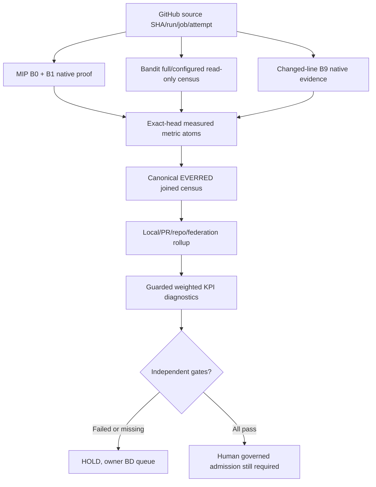

# CODE PURPLE / MIP - B-family metric hierarchy N1

Status: **DRAFT / ADMISSION HOLD**, 17 October 2026.

This is a **namespaced, read-only registry**, not a replacement for
`tools/everred_v3/src/metrics.py`, the existing EVERRED DAG or #1929.
The full executable metric dashboard is delivered separately as a
source-and-QA bundle; it is not claimed to be merged or installed here.

## Namespaces, not one B0-B9 flight

| ID | Contract | Evidence |
| --- | --- | --- |
| MIP.B0 | Canonical tests, report-only, DAB and admission | Native B0 Actions |
| MIP.B1 | False-green census, a B0 child | Native B1 job |
| BANDIT.B1 | Full/configured security producer | Manifest, not launch |
| BANDIT.B2 | Other source findings | Disjoint full scan |
| BANDIT.B3 | Subprocess security | Disjoint full scan |
| BANDIT.B4 | Files, permissions, secrets | Disjoint full scan |
| BANDIT.B5 | Test infrastructure | Disjoint full scan |
| BANDIT.B6 | Read-only owner/replay fan-in | Configured, unverified |
| COVERAGE.B9 | Changed-line coverage floor | Matrix gate |

Do **not** confuse BANDIT.B4 with scanner rule `B404`, or
MIP.B1 with BANDIT.B1. The latter are not nested.
No continuous MIP.B2..MIP.B8 sequence is established.

## Fixed-sample execution denominator

Native exact-head, nonrandom, non-atomic 15-PR sample:

- MIP.B0: 13/14 terminal workflows SUCCESS (92.86%).
- MIP.B1: 14/14 false-green jobs SUCCESS (100%).
- MIP.B0 child jobs: 180/182 SUCCESS (98.90%).
- B0 workflow presence: 14/15 selected PR heads.
- Sampled named workflows: 395; B0=14/395 by *run count*.
- Native runner-machine IDs and fleet-wide workflow share: UNKNOWN.

The single failed flight was [#2054 B0 38903706823](
https://github.com/GBOGEB/ABACUS/actions/runs/38903706823):
canonical coverage and dependent admission FAILED, B1 passed.

The highest B0 run ID observed was [39029698384](
https://github.com/GBOGEB/ABACUS/actions/runs/39029698384),
#2097 head `ce2a867deedd4b8649e4607d7fc59b2923cb3cc1`,
13/13 native jobs PASS. Not proof of #2097's separate cohort
testflight, not main admission, and not authenticated Crew execution.

## Historical security scope (not current full debt)

[Bandit full-scan run 38539036478](
https://github.com/GBOGEB/ABACUS/actions/runs/38539036478),
[artifact 11881129870](
https://github.com/GBOGEB/ABACUS/actions/runs/38539036478/artifacts/11881129870),
exact `03ddd8db94fd84d06bb8fd7257e2845659d858c0`:

| Owner | Findings | Share of 6,393 |
| --- | ---: | ---: |
| B5 test infrastructure | 5,950 | 93.07% |
| B3 subprocess | 267 | 4.18% |
| B4 files/secrets | 176 | 2.75% |
| B2 other source | 0 | 0.00% |

These counts form **one exclusive full-scan population**.
Configured scan has 3 findings in a separate denominator.
Volume rank B5 > B3 > B4 > B2; risk/priority must consider
severity, verified roots and cleared consumer PRs independently.

## Mathematical hierarchy

Raw source-bound atoms -> local test/module -> PR -> repository ->
federation -> diagnostic KPI. Top-down drilling must preserve the
same evidence identity. Never add parent and child observations twice.

| Measure | Estimator | Eligibility |
| --- | --- | --- |
| Coverage | k/d | scope/config + nonzero denominator |
| Velocity | delta C / delta N | source and population matched |
| Acceleration | delta v / delta N | three matched points |
| Yield | accepted delta / resource | independent acceptance |
| Stability | rolling MAD, variance | >=3 matched; up to N20 |
| Persistence | same state transitions / eligible transitions | fixed scope |
| Root leverage | distinct verified consumer PRs / cause | canonical root |
| Saturation | newly covered items / new tests | unchanged source |
| Forecast error | actual - earlier prediction | immutable prediction |

## Objective scores

`qualified_evidence_readiness`, `fanout_root_return` and
`temporal_reliability` are configured in the machine-readable
registry with normalized weights. **All remain UNSCORED** until their
declared independent inputs have the required native provenance.
MIP.B0 and its child MIP.B1 cannot be added to the same independent
composite. Missing evidence stays NULL, not zero; no partial-weight
renormalization.

Security, A10, governance, reviews, effective protection and
exact-head admission are **hard AND gates**. Scores never waive gates.
Accepted main/diff coverage, formal BD root counts and authenticated
CODEX Crew/REX launches remain UNKNOWN.

## Existing source DAG and SIPOC

S = ABACUS/CODEX native sources, I = immutable receipts,
P = join/validate/reduce/forecast/score, O = diagnostic view and
qualified BD queue, C = owner, reviewer and federation consumers.

Follow-on N+1: integrate exact-head native coverage via #2106
temporal gate and #2113 matched source converter. N+2: N20
rolling-series calibration only after comparable observations.
N+3: qualify root leverage through #1929, without changing
existing root authority or reviewer/security controls.

`authority_transfer=false`; `security_waiver=false`;
`merge_admission=HOLD`.
