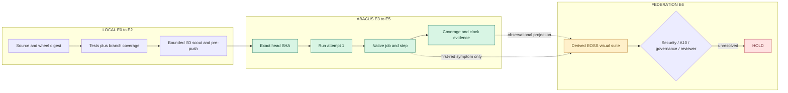
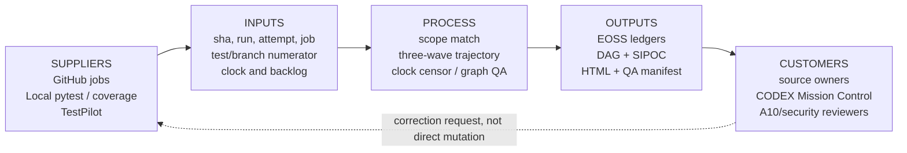
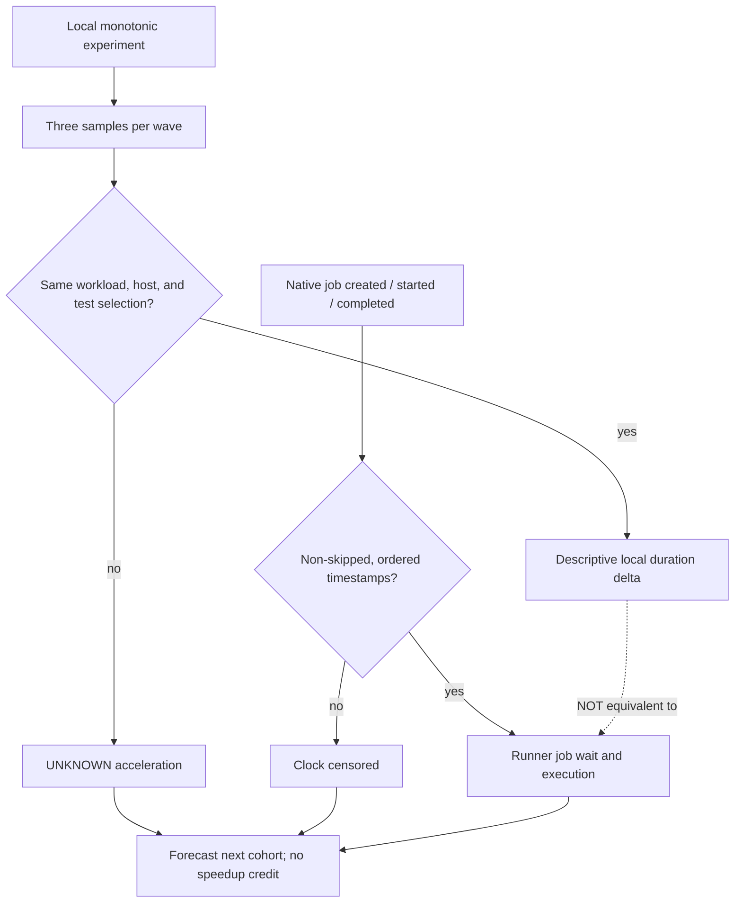

# CODE PURPLE EOSS N6 — Three-wave glossary and interpretation

**Scope:** LOCAL E0-E2, REPO E3-E5, FEDERATION E6. EOSS remains a family of review projections; no new SSOT.

- **Wave W7/W8/W9:** a bounded engineering increment with a committed or locally reproducible source/test output and an explicit receipt.
- **Pulse:** the observation and verification checkpoint inside a wave, not a separate unlimited execution batch.
- **Stability:** repeated matched measurements with differences within a predeclared tolerance. Three compared pairs require FOUR wave states.
- **Acceleration:** a second difference of coverage changes or an independently matched runtime speedup. A negative second difference is deceleration of gains, not declining absolute coverage.
- **Convergence:** a descriptive approach to a coverage plateau or diminishing remaining unknowns; it is not certified causal convergence.
- **Plateau:** constant measured coverage may be 100% or 20%. It never proves sufficiency without absolute quality gates.
- **Coverage:** measured statements and branch opportunities in a fixed source scope, not all-repository or diff coverage unless separately verified.
- **Predicted / planned / actual:** a prior-issued quantitative forecast, an operational target, and an independently measured result. No retroactive scoring.
- **First-red:** native run:attempt and failed job step; a recurring workflow name alone does not confirm causal root.
- **Job wait:** native job.started_at minus job.created_at if both ordered and same job. Run.created_at is NOT a queue-wait proxy.
- **Runner execution:** native completed_at minus started_at; skipped or inverted clocks are censored.
- **Asyncio:** cooperative, bounded I/O fan-out; simulated network waits do not certify GitHub throughput improvements.
- **Wheelhouse:** hash-qualified ABI/OS/lock/wheel cache; any CoolProp or other wheel savings require same-cohort measured cold/warm trials.
- **Unlisted / enumerated / untested / UNKNOWN:** different denominators and evidentiary statuses; never translate unknown into zero.
- **DAG:** directed process/provenance graph. Dashed observational or co-occurrence edges are not causal.
- **SIPOC:** Supplier, Input, Process, Output and Customer contract, with source-owner feedback loops.
- **Governance:** independent A10, security, CI policy, branch protection and human reviewer remain HOLD until accepted.

## Reader navigation

View the [interactive HTML](eoss_n6.html) for trajectory, evidence clocks, and expansion status. The three Mermaid source diagrams are `eoss_n6_process.mmd`, `eoss_n6_sipoc.mmd`, `eoss_n6_clock.mmd`; each is reproduced below with a narrative.

## Process DAG

The process path is directional. Candidate symptom evidence returns to an owner, not directly to a merger.

## SIPOC

The output suite is a projection of source receipts; customer feedback is a new owned change request.

## Clock scope

No local build or simulated I/O result is a GitHub runner or CoolProp speedup.
