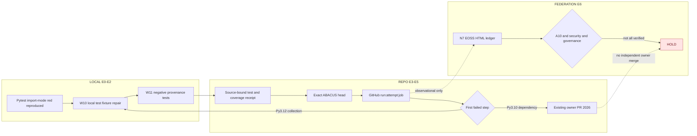
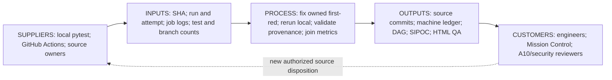
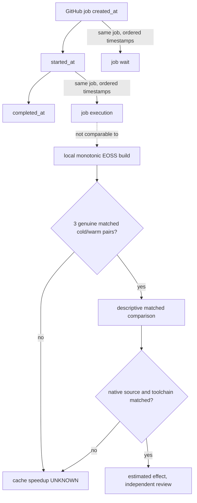

# EOSS N7 — W10–W12 continuation, glossary & narratives

> Source-bound review projection; no new SSOT. GitHub admission HOLD.

## W10 native failure and disposition
Native 3.12 collection failed at the EOSS test module import, reproduced and repaired in owner branch #2090; native CI for the newer head is not yet terminal. Python 3.10 still fails independently to install matplotlib>=3.11.2, whose canonical owner is #2026.

## W11 testing and coverage
171/171 local tests passed, 488/488 statements and 114/114 branch opportunities for five bounded EOSS modules. Since the source scope grew, this is NOT a +85-statement improvement on a fixed denominator, nor ABACUS main coverage.

## W12 visual and runtime projection
DAG edges indicate real process sequence or dashed observational relationships. SIPOC feedback is a source-owner request and may not mutate canonical evidence. Clock differences are computed only when native job timestamps share an identity; a skipped/inverted or absent clock must be censored. No cache savings were measured.

## Local / repo / federation glossary
**LOCAL:** import isolation, pytest/coverage.py, monotonic build clocks,
development wheelhouse, pre-push.  
**REPO:** head SHA, run/attempt/job/step, terminal source proof, B0 canonical
coverage, documented first-red.  
**FEDERATION:** cross-repo owner map, DAG, SIPOC, REX, Mission Control,
independent admission.

**Wave:** bounded source-engineering change plus test and evidence receipt. **Pulse:** one observation/validation cycle inside a wave. **Plateau:** unchanged matched coverage across consecutive comparisons; not permission to merge. **Acceleration:** a qualified second difference or matched end-to-end runtime improvement. **Causal root:** only authorized independently attributable confirmed reason, not a repeated step label. **Enumerated / unenumerated:** distinct inventory statuses.

**Known but not tested** is not the same as **tested but failed**, **censored**, **queued**, or **unknown**. Each category has its own denominator.

## Directed process / evidence DAG

## SIPOC and owner feedback

## Execution-clock and cache experiment

