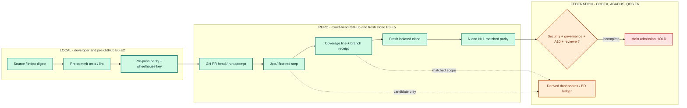
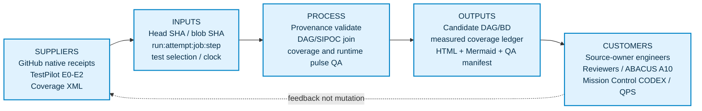
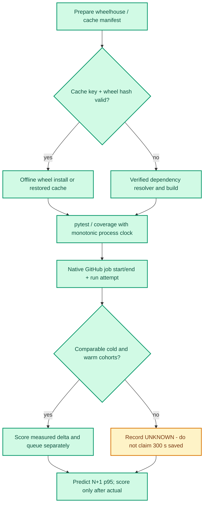

# CODE PURPLE | Evidence & Observability Surface Suite (EOSS)

> An EOSS is a *family of evidence-linked human review surfaces*, not a new SSOT.

## Architecture and diagram narrative



**DAG narrative.** Local E0-E2 guards establish the source tree and cached dependency identity. Repo E3-E5 binds the exact PR head to run/attempt/job/step and fresh-clone parity. E6 is an independent federation admission gate. Dashed edges to dashboards are observations and may not be read as confirmed causes.



**SIPOC narrative.** Source suppliers produce versioned, immutable evidence. The process validates identities and denominators. Its outputs are review projections for owners and reviewers, not an alternate root ledger.



**Execution-clock narrative.** Warm-cache results only become speedup evidence when cold/warm runs share OS, Python ABI, dependency/wheel hashes, selected tests, runner class and observation windows. Queue delay, runtime and wall-clock elapsed are separate metrics.

## Three pulses: planned versus actual

| Pulse | Planned | Actual observed | Qualification |
|---|---|---|---|
| P1 | eligible_lines_covered_pct=80, eligible_branches_covered_pct=75, new_test_cases_recorded=9 | eligible_lines_covered_pct=100.0, eligible_branches_covered_pct=95.7447, new_test_cases_recorded=9 | SOURCE_EQUIVALENT |
| P2 | unique_runs_read=60, job_readbacks=350 | unique_runs_read=60, job_readbacks=387 | HISTORICAL_OBSERVATION |
| P3 | native_job_durations_captured=293, target_p95_job_seconds=240.3, actual_warm_cache_saved_seconds=UNKNOWN | native_job_durations_captured=293, target_p95_job_seconds=267, actual_warm_cache_saved_seconds=UNKNOWN | HISTORICAL_OBSERVATION |

**Coverage scope.** The two selected DMAIC files have 269/269 measured statements and 90/94 measured branches (100.0% and 95.7447%). Executing commit 36d628f9c9deb0efcc11e3aa9ffc164075b75470 differs from PR head fe05c6865f00d40def80996390ff0cf7c002562f, though measured file blobs match. Only content-equivalent module proof is supported, not accepted exact-head main/diff coverage.

**BD / unknowns.** 60 of 253 historical runs have a limited first-page latest-attempt job readback; 193 have not. 56 candidate signatures are not 56 confirmed roots. Untested and unenumerated counts remain UNKNOWN until censused.

**Time evidence.** Prior temporal samples record 293 measured job durations, 10 censored/inverted timestamps, p50=121 s, p95=267 s; actual runner queue waiting and any CoolProp/wheel cache time savings are UNKNOWN.

## Surface family taxonomy

| Tier | Authority owner | Recommended surface family |
|---|---|---|
| LOCAL | TestPilot/developer | hook telemetry, cache key, test selection, source tree digest |
| REPO | ABACUS/EVERRED/CBD | DAG, SIPOC, BD queue, coverage ledger, native CI timeline |
| FEDERATION | Mission Control CODEX / ABACUS governance | repo portfolio, REX, root-owner crosswalk, admission gates |

## Global execution glossary

- **EOSS:** Evidence & Observability Surface Suite; a proposed umbrella name for DAG/SIPOC, run ledger, CBD burndown, dashboard, atlas, metric telemetry and review receipts.
- **SSOT:** canonical governed system of record; generated HTML, charts and ledgers are projections unless explicitly promoted.
- **DAG / edge / atom:** Directed acyclic process topology / typed relationship / smallest version-bound run, attempt, job, step, test or evidence record. Co-occurrence is not causality.
- **SIPOC:** Supplier-Input-Process-Output-Customer diagram, including responsible repository boundaries.
- **BD / CBD:** Burndown / causal burndown; outstanding symptom associations, confirmed roots and accepted closures require independent denominators.
- **First-red:** earliest authenticated failing job step in a precise workflow run attempt; a candidate step signature is only a grouping.
- **Collected / executed / passed:** three distinct test counts; asserting a collected test exists is not evidence it passed.
- **Statements / branches / diff coverage:** eligible executable statements, branch opportunities and changed-line scope; do not combine incompatible denominators.
- **Unenumerated / untested / unknown / queued:** not yet listed, code lacking measured test coverage, missing value, and scheduled pending execution. These are not interchangeable or zeros.
- **CPU time / wall time / queue / job runtime:** different clocks. Use monotonic process clocks and native GitHub job.created/start/end timestamps; never infer runner queue wait from run creation.
- **Asyncio:** bounded I/O concurrency for scouts, not a substitute for parallel CPU execution or an authenticated dispatcher. Cap read-only scouts and source-owner leases.
- **Wheelhouse / cache key:** prebuilt hashed Python wheels and a key spanning OS, Python ABI, lock digest, dependency index and wheel digest. Verify before offline reinstall.
- **Planned / predicted / actual:** predeclared target, frozen future estimate, and subsequently source-bound measurement. Score only a prediction issued before the measured target.
- **A10 / security / governance / review:** independent HOLD gates; no diagram or statistical plateau can waive these.

## User cheat-sheet: broad surface prompt

> Build or update the **CODE PURPLE EOSS** across **LOCAL / REPO / FEDERATION**: Mermaid process DAG, causal-candidate versus verified graph, SIPOC with narrative, interactive HTML evidence atlas, CI/clock/cache timeline, coverage heatmap and numerator/denominator ledger, CBD queue with known/unknown/unlisted/untested states, planned/predicted/actual three-pulse DMAIC chart, glossary and command cheat-sheet. Bind every panel to repo/PR/head/run/attempt/job/step/coverage source. Include visual QA screenshots, responsive interaction tests, hashes and independent HOLD gates. Separate historical, current-head, content-equivalent and unverified evidence; never claim merges, root closures, or performance gains without source-bound proof.

## Reproducible operator commands

```bash
# Native evidence adapter: requires a previously downloaded authenticated GitHub ZIP
python scripts/cbd_eoss_projection.py --coverage-zip /path/to/native-test-evidence.zip --out ./eoss_out
# Targeted negative + execution contracts, with explicit branch coverage
python -m pytest -q tests/test_cbd_eoss_projection.py tests/test_cbd_eoss_runtime_probe.py --cov=scripts.cbd_eoss_projection --cov=scripts.cbd_eoss_runtime_probe --cov-branch
# CI job evidence: bind the exact PR head and run:attempt; do not assert queue wait from run-created timestamps
```

**Wheelhouse and asyncio:** `scripts/cbd_eoss_runtime_probe.py` implements a deterministic lock/ABI/OS/wheel cache key, a fail-closed cold/warm pairing contract (at least three matched trials), and a read-only asyncio scout with a hard maximum concurrency of four. These are tested local contracts; no GitHub Crew launch, package preload, 300-second speedup or runner-time improvement is claimed.

## Scope and source receipt

```json
{
  "acceptance": {
    "authority_transfer": false,
    "main_merge_authorized": false,
    "security_waiver": false,
    "state": "HOLD"
  },
  "provenance": {
    "coverage_artifact_file": "test-evidence-py3.12-36d628f9c9deb0efcc11e3aa9ffc164075b75470",
    "coverage_artifact_id": 12098690913,
    "coverage_execution_sha": "36d628f9c9deb0efcc11e3aa9ffc164075b75470",
    "coverage_head_sha": "fe05c6865f00d40def80996390ff0cf7c002562f",
    "coverage_pr": 2099,
    "coverage_source_artifact_run_id": 39024853467,
    "coverage_source_blob_checks": "two source files and three test files identical at both SHAs",
    "current_head_native_main_coverage": null,
    "everred_fanin_pr": 2077,
    "everred_fanin_sha": "00cc896802b426c6b222c2557338e54412a51062",
    "graph_owner_pr": 2090,
    "temporal_evidence_kind": "HISTORICAL_NONATOMIC_TEST_ASSERTIONS"
  },
  "schema": "code-purple.eoss.snapshot.v1"
}
```

**Residual gates:** GitHub exact-head native coverage, broad main/diff numerator/denominator, verified forecast scoring, independent security/A10/reviewer checks, effective branch protection, and actual wheel/cache cold-warm measurement.
