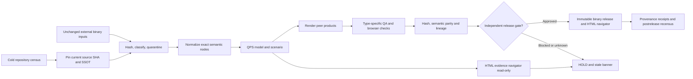

# Mission Control Wide — Cold artifact spine and presentation DAG

Status: **candidate implementation**; derived HTML is a view, not source authority.
Owner: ABACUS outward-product layer; child QPS source authority stays external.

## Canonical inputs already in this repository

- `ssot/ssot_style.json`: canonical typography, palettes, artifact QA and stale-state rules.
- `docs/ci/SSOT_STYLE_PIPELINE.md`: existing DMAIC/renderer QA contract.
- `analytics/qps_cost_estimate_roundtrip/docs/ARTIFACT_PRODUCT_CONTRACT.md`: peer product lineage.
- `analytics/qps_cost_estimate_roundtrip/config/output_product_priority_v0_1.yaml`: navigator-first QPS output order.
- `feedback/qps_w11_binary_manifest_replay_contract.yaml`: confidentiality and immutable binary source policy.
- `ci/governance/workflow_policy.json`: workflow trigger and lifecycle classification.

The new catalog at `docs/mcw/artifact_catalog.v1.json` references real checked-in JSON, YAML, YML, Markdown and HTML examples, plus existing QPS Excel/PPTX/PDF generator files. DOCX and Otter are *controlled-input types*, not invented public uploads. Missing or unmounted inputs are clearly marked UNKNOWN.

## Process DAG (direction of authority follows the arrows)



## Trigger controls

| Trigger | Fast action | Heavy/controlled action |
| --- | --- | --- |
| New checkout/cold start | Exact Git SHA + static tree census | None |
| SSOT, style, generator or catalog PR | Source hashes, path/graph checks, unit QA and static HTML | None |
| Uploaded binary from owner | Preserve bytes; compute/check SHA-256 and confidentiality label | Authorized extraction only |
| QPS normalized model update | Mark descendants stale; structural diff | Qualified recalculation |
| Manual controlled release | Reuse previously qualified source/calc IDs | Office/PDF render, dual-build replay and human gates |
| Postmerge approved release | Verify exact-head lineage and QA | Publish governed immutable release |
| Schedule | Cold source and stale/reachability census | Never silently regenerate binaries |

### Executable first slice

```bash
python -m unittest discover -s tests -p test_mcw_artifact_explorer.py -v
python tools/mcw_artifact_explorer.py --root . \
  --catalog docs/mcw/artifact_catalog.v1.json \
  --style ssot/ssot_style.json --html /tmp/mcw-artifacts.html \
  --receipt /tmp/mcw-artifact-receipt.json
```

The output is a **single self-contained HTML file** supporting search, type filtering, cards, evidence states, dependency IDs and source links pinned to the exact source commit. It reads no private app data or internet API. `file://` viewing works without a server. JSON receipt stays alongside it for automation.

## Binary roles and roundtrip policy

| Type | Repository reference | Policy |
| --- | --- | --- |
| JSON/YAML/YML/MD | Real paths listed by typed catalog | Versioned source; local bytes SHA-256 on cold checkout |
| HTML | Existing docs and generated read-only evidence navigator | QA links/contrast/overflow, show style and source hash |
| XLSX | `scripts/build_qps_ssot_views.py` | Generate from qualified QPS rows, structural/formula QA, hash output |
| DOCX | Controlled original document, or qualified future narrative generator | Preserve original bytes; do not claim a generator that was not observed |
| PPTX | `MINERVA_PID/generator/build_dissection_pptx.py` | Generate; verify slide count, speaker notes and visual QA |
| PDF | `MINERVA_PID/generator/build_temp_gradient_pdf.py` | Generate; verify page render and no blank/clipped pages |
| Otter transcript/audio | Controlled external source (not observed in public repo) | Require owner consent, exact locator and source hash before extraction |

**df Δ=0** means no *tabular semantic changes*, not identical XLSX ZIP bytes. An original controlled input can only be called byte-unchanged after the current SHA-256 equals its pinned digest. Derived products require their *own* output SHA-256, build identity, SSOT hash and QA receipt; no binaries are committed to the public source repo.

## Spine/backbone evaluation

Keep current ABACUS/CODEX/QPS SSOT and read-only typed DAG as the first-party source of engineering authority. Candidate public interoperability layers:

- [OpenLineage](https://openlineage.io/docs/spec/): optional run/job/dataset events for CI/runtime instrumentation.
- [RO-Crate](https://www.researchobject.org/ro-crate/specification.html): optional portable evidence-release package.
- [GitHub artifact attestations](https://docs.github.com/en/actions/how-tos/secure-your-work/use-artifact-attestations): independently verifiable build identity/subject hashes.
- [in-toto](https://github.com/in-toto/attestation): future signed predicate bindings between build and release stages.

Do not substitute any of these for QPS source authority. No remote backend, container service or cache is required for the cold UI. Evaluate a hosted event/lineage backend only after actual producer/consumer volume or stale-state latency justifies it.

## Acceptance/limitation

Run native Linux checks for unit tests, generated HTML, semantic repeatability, source paths, no binaries in PR and direct source SHA. Browser QA for keyboard navigation, search/filter, link integrity, overflow and stale banner remains an independent gate. Existing `ssot/ssot_style.json` includes an unavailable QPS style-path probe; surface its missing status rather than silently claiming complete style convergence. External source packs and native peer artifacts are not present here; no accepted publication, merge authority or 14-package closure is inferred.
