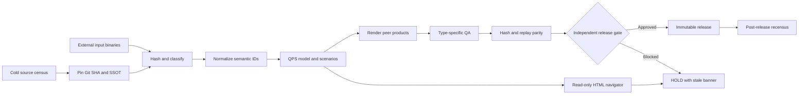

# Mission Control Wide - Artifact Cold Build DAG

Status: candidate. The HTML is a read-only view, not source authority.
Canonical style: `ssot/ssot_style.json`.

## Reuse existing contracts

- `ssot/ssot_style.json`: palette, typography and artifact QA.
- `docs/ci/SSOT_STYLE_PIPELINE.md`: style and DMAIC control.
- QPS artifact product contract:
  `analytics/qps_cost_estimate_roundtrip/docs/ARTIFACT_PRODUCT_CONTRACT.md`
- Output priority contract:
  `output_product_priority_v0_1.yaml` in QPS cost configuration.
- Binary source replay contract:
  `feedback/qps_w11_binary_manifest_replay_contract.yaml`
- Workflow classification: `ci/governance/workflow_policy.json`.

The catalog at `docs/mcw/artifact_catalog.v1.json` references five
real public files: JSON, YAML, YML, MD, and HTML. Existing generators
are listed for Excel, PPTX, and PDF. DOCX and Otter are controlled-input
examples; no external bytes or access rights are assumed.

## Execution graph



## Change and execution triggers

- Cold clone: census tree, SHA, source nodes and expected outputs.
- SSOT changed: pin hashes and invalidate downstream dependencies.
- Owner binary supplied: hash, classify, quarantine, then extract.
- Source evidence changed: normalize exact source locators.
- Model changed: recompute only the affected dependency subtree.
- Output requested: manual QPS render outside the source repository.
- PR changed relevant paths: native style, catalog and HTML cold QA.
- Manual release: dual-build parity, binary QA and human decision.
- Postmerge approved release: immutable publication and recensus.

## Run from an exact checkout

```bash
python -m unittest discover -s tests \
  -p test_mcw_artifact_explorer.py -v
python tools/mcw_artifact_explorer.py --root . \
  --catalog docs/mcw/artifact_catalog.v1.json \
  --style ssot/ssot_style.json \
  --html /tmp/mcw-artifacts.html \
  --receipt /tmp/mcw-receipt.json
```

Outputs are a standalone HTML leaf/card navigator and a JSON receipt.
The HTML supports search, type filters, and expandable source excerpts.
Source paths link to exact-commit GitHub files. External binaries do not
get public links. The `file://` view needs no network or backend.

## Artifact families and source references

- JSON, YAML, YML, MD: actual bytes hashed in the trusted checkout.
- HTML: the existing portal and cold generated read-only navigator.
- XLSX: `scripts/build_qps_ssot_views.py` is an observed QPS builder.
- DOCX: controlled owner input; no public source bytes claimed.
- PPTX, PDF: moved to the private repo GBOGEB/MINERVA_PID (2026-10-25).
- Otter: potential external transcript/audio, not an observed file.

**Zero DataFrame delta is not binary identity.** To call an original
input byte-unchanged, compare its SHA-256 to the owner's pinned digest.
Derived outputs have separate SSOT identity, build ID, semantic hash,
artifact hash, QA, and qualified human disposition. Do not commit
original or generated binaries to the public Git repository.

## Public backbone candidates

Keep ABACUS/CODEX/QPS as the engineering authority. Explore:

- OpenLineage for portable job/run/input/output events.
- RO-Crate for self-describing portable evidence release bundles.
- GitHub artifact attestations for authenticated build provenance.
- in-toto for future signed, typed build/release predicates.

These are interoperability layers, not replacement SSOTs or waivers.
No hosted backend is needed for the first cold HTML deliverable.

## Known gaps and acceptance

Native Linux testflight must verify source paths, unit tests,
deterministic HTML, output hashes and no binary publication.
Browser QA separately verifies filtering, keyboard use, overflow,
console errors and source links at desktop and mobile widths.
Current style SSOT references a missing QPS navigator/style probe.
Show it as missing instead of claiming style convergence.
Native peer execution, security approval, merge and fourteen-package
closure remain independent HOLD decisions.

## Executable bounded DAG receipt

The native cold-build job runs `tools/mcw_artifact_dag_execute.py` after
the existing source/style validation and deterministic HTML generation.
The executable reads the typed catalog and the previously generated
artifact receipt; it never rewrites the child QPS SSOT.

Run using the checked-out Git SHA:

```bash
python tools/mcw_artifact_dag_execute.py --root . \
  --catalog docs/mcw/artifact_catalog.v1.json \
  --style ssot/ssot_style.json \
  --style-status /tmp/mcw-style-status.json \
  --html /tmp/mcw-a/artifacts.html \
  --receipt /tmp/mcw-a/receipt.json \
  --child-reference docs/mcw/qps_child_reference.v1.json \
  --sha "$(git rev-parse HEAD)" \
  --output /tmp/mcw-a/dag-execution.json
```

`CENSUS` and `SSOT_PIN` pass only after exact-head, artifact, catalog
and style hashes match the checked-out bytes. The QPS child pointer
is version-bound metadata, explicitly **not** authenticated source
binary evidence. `SOURCE_FREEZE` remains `BLOCKED` until the child
owner supplies the actual controlled evidence. Downstream modeling,
binary rendering, replay and release are not executed on a cold view.

The run artifact publishes `dag-execution.json` next to the HTML,
style report and read-only receipt. A source-only PASS is never a
release, engineering acceptance or merge authorization.
