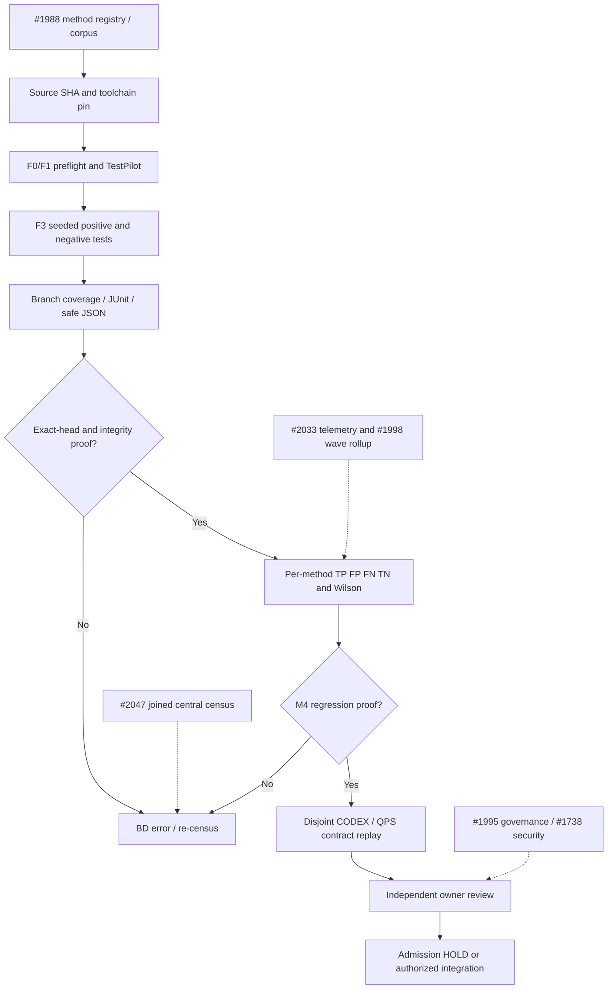
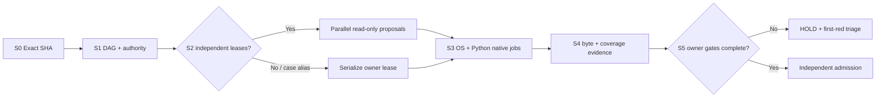

# MIP3 — Local-to-CI flight engineering and postflight method refinement

## Mission

Convert MIP2 method qualification into an attributable, repeatable local-first
  flight system. Preserve separate decisions for (1) testflight, (2) method
  qualification, (3) root resolution, (4) integration eligibility, and (5)
  merge admission.

## SIPOC

- Supplier: developer, scanner and CI.
- Input: exact SHA, configuration, test corpus and tool versions.
- Process: preflight -> seeded testflight -> postflight.
- Output: evidence receipt, JUnit and artifact hashes.
- Consumer: method registry, Mission Control and owner.

## Flight stages

1. **F0 discovery:** enumerate Python, OS, tools, versions, executable paths,
  pinned configuration; missing != failed test.
2. **F1 preflight:** exact Git HEAD, syntax compilation, schema validation,
  dirty-tree check (future), source/config hashes, dependency capability.
3. **F2 fast testflight:** contract and syntax checks; JSON telemetry; fail
  closed.
4. **F3 full testflight:** seeded Black/isort, Bandit, coverage tests; JUnit,
  durations and failures.
5. **F4 postflight:** match local receipt SHA to HEAD, parse JUnit, require
  nonzero tests, zero failures/errors/skips, verify actual bytes and SHA256.
6. **F5 native CI:** independent GitHub runner executes same contracts on exact
  PR head; no local receipt grants merge.
7. **F6 method admission:** measured TP/FP/FN, stability, diagnostic accuracy,
  repair yield and rollback evidence.
8. **F7 repository federation:** compatibility pilot in CODEX and
  cryoplant-project, separately verified.

## Method engineering DMAIC + 3P*

For **each** scanner or repair method: DEFINE intended rule/defect class and
  repair envelope; MEASURE paired corpus precision, recall, runtime and
  duplicate rate; ANALYZE missed/false/duplicate roots and first-red
  attribution; IMPROVE pinned configuration, adapters and repair algorithm;
  CONTROL seeded positive and negative tests plus semantic invariants; PREPARE
  baseline/candidate pairs; PROVE native reproducibility; PROPAGATE contracts
  to applicable repositories with rollback.

## KPIs and evidence fields

- **Detection:** TP, FP, FN and TN where ground truth exists; precision
  TP/(TP+FP), recall TP/(TP+FN); undefined denominators are UNKNOWN.
- **Diagnosis:** stable root-ID rate, duplicate signatures, attribution
  latency and provenance completeness.
- **Repair:** attempted, committed, verified, root-resolved and newly
  introduced first-reds; proposals are never counted as closure.
- **Efficiency:** p50/p95 wall time, worker hours, saved CI reruns,
  verification latency and verified roots per hour.
- **Coverage:** line and branch covered/eligible counts, percentage-point
  delta, new branch tests and risk weighting.
- **Integrity:** exact SHA, UTC, tool versions, JUnit, artifact SHA256,
  negative controls and immutable run links.
- **Governance:** A10 confidentiality, security, branch rules and
  independent acceptance, without pilot-driven waivers.

## Statistical plan

- Record paired baseline/candidate results on identical labeled cases;
  bootstrap confidence intervals only with adequate observations.
- Wilson intervals for binary detection/repair outcomes, with denominators
  disclosed.
- Pareto by unique root family and wasted verification time; avoid counting
  correlated workflows as independent defects.
- PCA only after sufficient repeated method-by-repository observations,
  missing-data handling and standardized features. Never infer causality from
  PCA.
- Control charts on repeatable per-method runtimes, failure rates and root
  yield after stable baselines.

## First-red and overflow treatment

Keep governance producer, governance admission, docs lint, A10 and formatting
  as separately attributed streams until logs prove shared roots. An unexpected
  error becomes an overflow finding with repo, exact SHA, run/job, signature,
  owner, evidence and UNKNOWN classification; no silent drop.

## Acceptance and release

- Local F1/F3/F4 PASS on same SHA; 4/4 seeded tests must actually execute and
  produce JUnit.
- CI F5 PASS on the **new** SHA and uploaded artifact bytes validated.
- First-reds repaired at source; no check disablement, weakened security,
  self-approval or premature merge.
- MIP3 method pilot success is not equivalent to resolving the eight historical
  BD roots.
- Re-run after each method improvement; record before/after values and preserve
  rollback.

## Known baseline (historical, not current-head admission)

MIP2 exact head 2f8de7b: 4/4 seeded tests PASS in 0.93 s, JUnit artifact
  11929400523 (455 bytes); 33 workflows, later 21 success, five failure, seven
  nonterminal. Subsequent local tooling commits 52c0b10 and 06b449d had not
  received completed native proof at last prior inspection.

## Follow-on implementation backlog

- MIP3-01: unify local and CI receipt schemas; enforce tool versions and
  dependency lock.
- MIP3-02: prevent pre-commit recursion and add staged-file syntax scope;
  handle dirty tree.
- MIP3-03: executable seeded corpus per method with true-positive/negative
  labels.
- MIP3-04: detect false greens by intentionally failing negative-control
  fixtures.
- MIP3-05: reproducible environment via pinned Python toolchain and optional
  Docker.
- MIP3-06: coverage risk-ranked branch selection and comparable denominators.
- MIP3-07: scanner fingerprint federation, LDAB joins, root IDs, overflow
  queue.
- MIP3-08: runtime LLDB/Docker session receipts and debugger crash signatures.
- MIP3-09: paired statistical experiment runner, confidence intervals, Pareto
  and PCA readiness.
- MIP3-10: method promotion and rollback by independent repository proof.


## 16 October 2026 — source-owned evidence-integrity hardening

Canonical implementation and method registry remain in ABACUS PR #1988
(`tools/mip2/`). Draft PR #2048 introduced a redundant top-level
registry; retain #1988 as the sole method-qualification SSOT. Method
qualification remains independent of admission and engineering-root closure.

### Root-specific repair contract

1. Source checkout **shall** match the GitHub event PR head, not the
   synthetic merge ref. The workflow checks `git rev-parse HEAD`.
2. Local receipts **shall** carry valid Git identity; absent Git,
   mismatched expected head and incomplete tests are non-PASS.
3. Diagnostic command stdout/stderr shall not appear in uploaded
   local-flight JSON because those streams can contain sensitive values.
4. JUnit parsing shall use `defusedxml`, reject DTD/entity input and
   invalid/missing/contradictory counts, and cap input bytes.
5. Registry validation shall retain its behavior under `python -O`
   (plain `assert` statements are not enforcement).
6. The method CI workflow shall publish actual branch-aware coverage JSON,
   JUnit and pinned dependency versions. Coverage is a measured scope,
   not implied repository-wide improvement.
7. The proposed `method_effectiveness.py` computes TP/FP/FN/TN,
   Wilson recall bounds, actual observed-case completeness, distinct
   scanner signatures and runtime; malformed or incomplete evidence is
   rejected or classified insufficient. Neither M3 repair nor M4–M6
   qualification is self-awarded.

### Canonical dependency DAG



The diagram is a process proposal; neither a Crew dispatch nor a native
federation receipt is inferred from its edges.

### SIPOC — method development

| Role | Controlled contribution |
| --- | --- |
| Supplier | Native CI, scanner owners, CodeQL, Bandit, LDAB, reviewer |
| Input | Exact SHA, pinned tool, corpus bytes, labels, run/job/attempt |
| Process | Define, measure, analyze, improve, prove, propagate, control |
| Output | Fail-closed receipt, coverage counts, scanner confusion matrix |
| Consumer | #1988 qualification owner, #1929 BD/LDAB, Mission Control |
| Authority | ABACUS admission; CODEX/QPS retain independent boundaries |

### Disjoint existing owners — do not duplicate

- #2047 owns JOINED_CENSUS, disjoint recensus and orchestrator proposal.
- #2033 owns exact-SHA CI queue and worker telemetry.
- #1998 owns cross-wave root and coverage comparability.
- #1997 owns the W70 producer and native measurements.
- #1989 owns seven-family statistical-readiness contracts.
- #1995 owns workflow-policy and generated inventory rules.
- #2040 owns DOW coverage-mode repair; #2045 owns Python 3.9 and
  Enterprise fail-closed CI compatibility.
- #2027 and #1738 own Safety/Bandit security-debt investigation.
- #1860 owns merge-admission HOLD; #1929 owns BD/LDAB joined evidence.

### Quantitative interpretation

Source-bound scanner precision and recall require complete labeled
positive/negative fixture observations. A missing fixture result is
INSUFFICIENT_EVIDENCE, not FN or PASS; absent fingerprints are not
independent engineering roots. Paired method improvement requires the
same source and corpus bytes. No counted method observation or generated
coverage JSON grants merge permission.

PCA, BT and control-chart claims remain deferred until independent,
comparable multivariate series have sufficient observations and actual
worker/repair outcome identities. Declare missing effort and latency
fields UNKNOWN, never zero.

### Required impact re-census after every change

Refresh PR #1988 exact head, terminal native MIP2 job and artifact
bytes, changed-file coverage and first-reds. Compare impacted open
#2046 (C2), #2045, #2040, #2047, #2033, #1995 and #1998 owners by
changed paths and accepted receipts, not by PR count. Record new or
retired comments separately from engineering-root closures. Preserve
security, A10, governance, required-check enforcement and independent
review as separate P0 admission conditions.

## W74 — disjoint DAG planning and native-proof frontier

**Scope:** `tools/mip_testflight_plan.py` is the read-only DAG wave
planner; `tools/triage/mip_v3_frontier.py` is a separate read-only
candidate ranker. Neither dispatches jobs. Both now use conservative
casefolded lexical file/directory leases to avoid proposing simultaneous
ownership of equivalent Windows paths. Authentication, symlink/realpath
resolution and native runner evidence remain separate obligations.

### Operational SPLINE

| Spine | Input | Output | Evidence boundary |
| --- | --- | --- | --- |
| S0 | Exact source/base/previous SHAs | Bound cohort | JSON is a declaration |
| S1 | Task DAG and dependencies | Cycle/authority check | Mutation descendants withheld |
| S2 | Paths, pools, worker cap | Disjoint proposal batches | Lexical, not a launch |
| S3 | Python/OS matrix | JUnit, run/job/attempt | Terminal native jobs required |
| S4 | Coverage + artifact hashes | Matched receipt | Source and denominators bound |
| S5 | Security, governance, review | HOLD or eligible | Independent owner decision |

### Dependency DAG



### SIPOC

| Supplier | Input | Process | Output | Consumer |
| --- | --- | --- | --- | --- |
| CENSUS / BD / LDAB | Root, path, exact SHA | Lease + DAG check | Read-only batches | Native CI |
| GitHub jobs | OS/Python, run/job/attempt | Test and classify | JUnit + receipt | MIP / TODO |
| Governance owner | Rules, security, review | Independent gates | HOLD or qualified | ABACUS owner |

**Worker economy:** fill unused slots with noncolliding tasks; serialize
ancestor/child or Windows casefold aliases. Summed maximum *estimated*
batch durations are proposals, never observed runner-seconds.

**Existing YAML / Docker boundary:** `ci/cbd_recurse_local_w48.yaml`
describes separate read-only pool ceilings; it does not prove live
GitHub capacity. Current repository YAML workflows own native CI.
No competing workflow, container execution or remote dispatch is enabled.
Container IDs and image digests require independently executed receipts.

### Source-owned fast regression tests

```bash
python -m unittest discover -s tests -p "test_mip_testflight_plan.py" -v
python -m unittest discover -s tests -p "test_mip_v3_frontier.py" -v
```

Positive, reverse and negative controls cover exact/ancestor/descendant
and casefold collisions, sibling boundaries, concurrency caps, deterministic
ordering, unsafe paths and changed-file scope. Keep all final-PR-head
coverage numerators/denominators and native CI/security evidence separate.
No inferred dispatch, review, root closure or admission credit.
