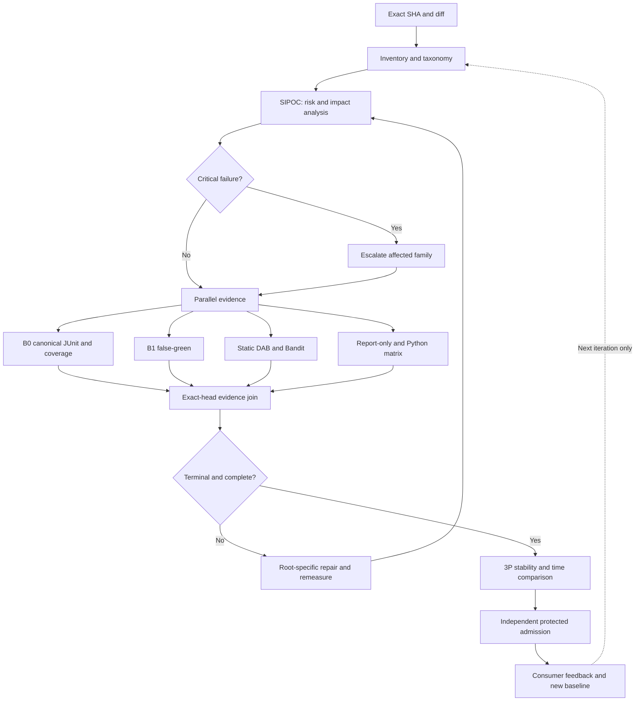

<!-- markdownlint-disable MD013 MD060 -->

# MIP / 3P* SIPOC-DAG reuse contract

Status: advisory engineering design; not admission evidence.

## SIPOC

| Supplier | Input | Process | Output | Customer |
|---|---|---|---|---|
| PR author / GitHub | Exact SHA, changed paths, test node IDs | Unique inventory, category classification, impact planning | Deterministic census and risk plan | MIP B0 |
| Canonical CI / scanners | JUnit, coverage XML, Bandit and static reports | Parallel B0, B1, static/DAB, report-only, matrix | Source-bound evidence and first-red queue | Independent reviewer |
| LDAB / 3P workers | Runner, OS, Python, timing and hashes | Repeat comparable experiments and reconcile drift | p50/p95, critical path, stability receipts | CI owner, non-authoritative consumers |

## Reusable execution DAG

## Evidence contract

1. Count unique collected node IDs once; category membership can overlap.
2. Measure collected, passed, failed, skipped, xfailed, test seconds, setup seconds, queue seconds and total wall time separately.
3. Bind JUnit, coverage and scanner evidence to exact SHA, interpreter, runner, dependency/configuration identity and artifact hash.
4. Report covered and eligible changed lines; UNKNOWN rather than an inferred percentage if artifacts are missing.
5. Classify complexity 1-5 only from measured duration, dependencies, environment and history. Otherwise UNMEASURED.
6. Fast diagnostics never substitute for required B0, security or governance admission.
7. Python 3.9 source-only proof is not package compatibility where pyproject requires Python >=3.11.
8. Escalate security reds to affected negative tests and scanner; compatibility reds to the relevant interpreter; runner outages to queue diagnostics.
9. Retire legacy workflows only after equivalence and branch-protection owner approval; preserve useful quick-start paths.
10. Reuse canonical workflows; do not manually modify generated docs/ci/WORKFLOW_RATIONALIZATION.md.

## Waves

- W1: taxonomy and advisory planning, PR #1921.
- W2: full collect-only census and source-to-test contexts.
- W3: JUnit timing and complexity distribution.
- W4: bounded 3P* repeatability and trigger escalation.
- W5: measured redundant workflow deprecation candidates.
- W6: independent admission and cross-repository consumer rollout.

Authority transfer = false; engineering credit = 0 until independently accepted.

## Execution-unit vocabulary for future instructions (G3A candidate)

The W1-W6 labels above are historical delivery waves, and existing 3P*
experiment/stability contracts retain their prior meanings.

- `3W`: three implementation waves with disjoint ownership, bounded fan-in
  and source-bound testflight; does not guarantee three accepted advances.
- `3MP`: three DMAIC/MIP measurement-and-improvement pulses; each cycle
  records distinct immutable observation/metric/defer/Control evidence.
- `G3A`: one kickoff and exactly three bounded **accepted engineering
  checkpoints**, from N→N+1→N+2→N+3, or stop immediately and return actual N
  with the first material blocker. Checkpoint advancement never substitutes
  for a GitHub merge, reviewer approval, security waiver or child authority.

See [G3A mission input, glossary, receipt schema, SIPOC and DAG](G3A_GOVERNED_THREE_ADVANCE.md).
The CODEX global semantic definitions are proposed in draft PR #1059;
ABACUS is a consumer and retains its existing scheduler.
