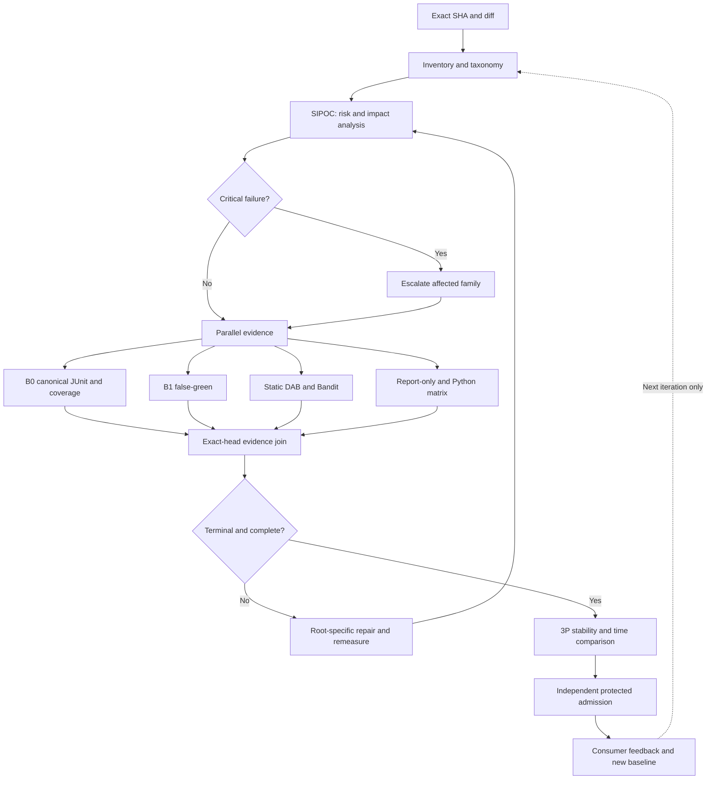
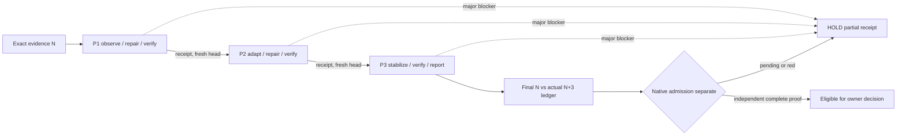
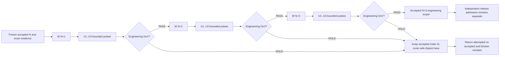

<!-- markdownlint-disable MD013 MD060 -->

# MIP / 3P* SIPOC-DAG reuse contract

Status: advisory engineering design; not admission evidence.

## SIPOC

| Supplier | Input | Process | Output | Customer |
|---|---|---|---|---|
| PR author / GitHub | Exact SHA, changed paths, test node IDs | Unique inventory, category classification, impact planning | Deterministic census and risk plan | MIP B0 |
| Canonical CI / scanners | JUnit, coverage XML, Bandit and static reports | Parallel B0, B1, static/DAB, report-only, matrix | Source-bound evidence and first-red queue | Independent reviewer |
| LDAB / 3P workers | Runner, OS, Python, timing and hashes | Repeat comparable experiments and reconcile drift | p50/p95, critical path, stability receipts | CI owner, non-authoritative consumers |

## Reusable execution DAG

## Evidence contract

1. Count unique collected node IDs once; category membership can overlap.
2. Measure collected, passed, failed, skipped, xfailed, test seconds, setup seconds, queue seconds and total wall time separately.
3. Bind JUnit, coverage and scanner evidence to exact SHA, interpreter, runner, dependency/configuration identity and artifact hash.
4. Report covered and eligible changed lines; UNKNOWN rather than an inferred percentage if artifacts are missing.
5. Classify complexity 1-5 only from measured duration, dependencies, environment and history. Otherwise UNMEASURED.
6. Fast diagnostics never substitute for required B0, security or governance admission.
7. Python 3.9 source-only proof is not package compatibility where pyproject requires Python >=3.11.
8. Escalate security reds to affected negative tests and scanner; compatibility reds to the relevant interpreter; runner outages to queue diagnostics.
9. Retire legacy workflows only after equivalence and branch-protection owner approval; preserve useful quick-start paths.
10. Reuse canonical workflows; do not manually modify generated docs/ci/WORKFLOW_RATIONALIZATION.md.

## G3A crosswalk: a three-pulse horizon within a wave

The canonical federation terminology is proposed in [CODEX #1060](https://github.com/GBOGEB/CODEX/pull/1060); ABACUS MIP/EXECUTION.md is the existing repo-level receipt register. This is a consumer crosswalk, **not** an alternate glossary or a new admission gate.

| Operator command | Exact scope | Expected unit evidence |
| --- | --- | --- |
| `next pulse` | One P, within current W | One observed/diagnosed/acted/verified/dispositioned record |
| `G3A` / `next 3 pulses` | Sequential P1, P2, P3, toward N+3 | At most three source-bound pulse receipts, adaptive priority, early STOP allowed |
| `next wave` | One bounded W | Outcome and DoV accepted/held with its own pulse history |
| `G3W` / `next 3 waves` | Three independent W campaigns | Three wave dispositions, potentially more than three pulses |
| `fan out` | Concurrency within a pulse | Disjoint source-owner leases; no shared-file write collisions |

For each pulse count planned vs executed tasks, current-head native tests, branch/line denominators, attributable first-red groups, runner timings and admission. A committed implementation or green focused test alone is not a verified wave or closed root. Always reconcile main/head/policy drift and preserve historical runs as historical.

## Waves

- W1: taxonomy and advisory planning, PR #1921.
- W2: full collect-only census and source-to-test contexts.
- W3: JUnit timing and complexity distribution.
- W4: bounded 3P* repeatability and trigger escalation.
- W5: measured redundant workflow deprecation candidates.
- W6: independent admission and cross-repository consumer rollout.

Authority transfer = false; engineering credit = 0 until independently accepted.

## GCA-3: wave/pulse terminology and governed N→N+3 advance

Adopt [GCA-3 terminology and execution protocol](../../MIP/GCA3_GLOSSARY_AND_PROTOCOL.md) as an operational naming overlay without changing this canonical SIPOC/DAG or the historical W1–W6 list. **Wave** (`W[N+i]`) = independently receipted, bounded delivery increment; **pulse** (`Uj`) = observe/diagnose/change-or-no-change/verify loop *within* a wave; **3P\*** P1/P2/P3 = methodology stages, not a pulse count. `GCA-3` = three attempted waves, default ≤3 pulses per wave, accepted index advances only by contiguous engineering DoV PASS. Independent branch/reviewer/security/A10/governance gates never inherit PASS from engineering tests.

The completed response shall return the wave receipts, first-red/BDQ root reconciliation, metrics before/after with matched scope, jobs/attempts, owner leases, and acceptance-vector/HOLD status. A source-head CI run that has merely been queued does not count as wave acceptance. No background execution is implied.

## Proposed USER SPINE and absolute weighted execution graph (18 October 2026)

The [N+i weighted source/readout and proposed user-prerogative layer](NPLUS_WEIGHTED_USER_SPINE_V1.md) is an **additive SIPOC projection** of this existing DAG. It shows three side-by-side, absolute-scale workflow-run graphs (runs, successful, failed) and the [corresponding Mermaid overlay](NPLUS_WEIGHTED_USER_SPINE_V1.mmd). This is not a replacement for canonical independent P0 admission, source-owner root proof, native JUnit/coverage evidence, or QPS engineering acceptance.

**USER SPINE:** the user supplies priorities, reviews competing governance/first-red/coverage/telemetry options, chooses/overrides/vetoes a bounded proposal, examines native results and provides feedback before the *next* iteration. The return is a feedback/reference edge rather than a causal or dependency edge inside the execution DAG. Selection alone does not launch workers, approve a PR, waive security or count engineering closures. N23's repeat QPS executions remain distinct from test-case count. An approved renderer may be published only after source-data hash and visual/browser QA; until then `P0=HOLD`.
