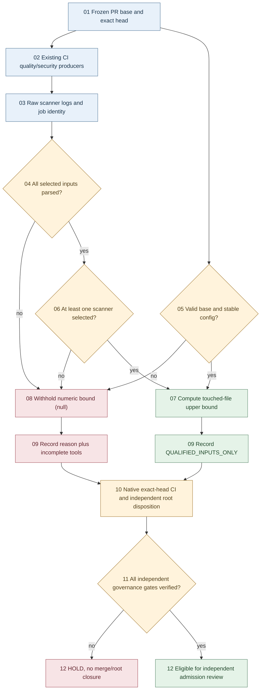

# CODE PURPLE W74 — Red-root evidence qualification DAG

## Authority and scope

This is a non-authoritative execution map for ABACUS [#1860](https://github.com/GBOGEB/ABACUS/issues/1860) and the causal-root ledger [#1929](https://github.com/GBOGEB/ABACUS/issues/1929). The current source repair lives in `scripts/red_root_delta.py`. The P41 W73 [#2351](https://github.com/GBOGEB/ABACUS/pull/2351) and cohort W72 [#2347](https://github.com/GBOGEB/ABACUS/pull/2347) write to separate paths. Admission remains **HOLD**.

## Directed acyclic graph: source to decision

The branch into a numerical upper bound is only an input-qualification gate. It does not assert that scanners exited successfully or that whole-main coverage improved.

## SIPOC and worker lanes

| SIPOC | Contract |
| --- | --- |
| Supplier | GitHub exact-head checkout, existing CI lint/security producers |
| Input | Frozen base SHA, changed paths, scanner stdout/logs, config-change inventory |
| Process | Normalize, parse, qualify, withhold or compute touched-file upper bound |
| Output | JSON schema `abacus-red-root-delta/1.0.0` and Markdown step summary |
| Customer | MIP wave controller, #1860 admission register, #1929 canonical root owner |

| Lane | Disjoint ownership | Acceptance evidence |
| --- | --- | --- |
| W72 cohort | Cohort workflow and test contract | Native Python 3.10/3.12, frozen cohort identities |
| W73 P41 | Git-status engine, CLI and tests | Nonzero blocked CLI, exact-head native suite |
| W74 red-root | Red-root census and its tests | Qualifier plus positive/reverse/adversarial native cases |
| Governance owner | Effective ruleset and independent reviewer | Required checks, eligible review, rejected RED canary |

## SPINE / SPLINE acceptance sequence

`N0 source SHA -> N1 input/log completeness -> N2 current candidate tests -> N3 native jobs and artifacts -> N4 independent security + governance -> N5 canonical root disposition`.

**Numerator/denominator rule:** a valid zero is a measured result for one fully selected and parsed input population; an unknown or missing source remains `null`. Never compare unrelated PR-head, global-main and focused module coverage as a temporal delta.

**Stop rules:** base drift, missing log, invalid parser, empty scanner population, configuration change, native failure, unresolved security, or absent independent review must block promotion of evidence to admission. Do not dispatch CODEX mutation or merge on the basis of this diagram.
