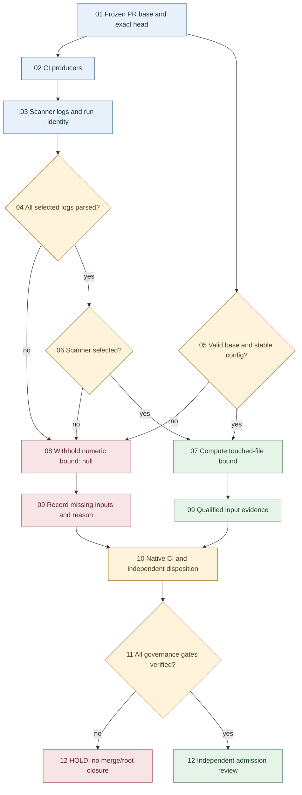

# CODE PURPLE W74 — Red-root evidence qualification DAG

## Authority and scope

Evidence aid for ABACUS #1860 and canonical BD/LDAB #1929.
W72 (#2347), W73 (#2351) and W74 (#2352) have disjoint writers.
Source owner: `scripts/red_root_delta.py`. Admission remains **HOLD**.

## Directed acyclic graph

The numeric bound qualifies input data, **not** scanner exit success.
Neither full-main coverage nor engineering root closure follows.

## SIPOC

| Step | Contract |
| --- | --- |
| Supplier | Exact-head checkout and existing CI producers |
| Input | Base, head, changed paths, logs and config changes |
| Process | Normalize, parse, qualify or withhold numeric bound |
| Output | Red-root JSON and Markdown CI step summary |
| Customer | MIP controller, #1860 admission, #1929 root owner |

## Disjoint worker lanes

| Lane | Ownership | Evidence |
| --- | --- | --- |
| W72 | Cohort workflow/test | Native Python 3.10/3.12 |
| W73 | P41 CLI/tests | Blocked exit, negative tests |
| W74 | Red-root census/tests | Parsed inputs, reverse tests |
| Owner | Ruleset/review | RED canary, required checks |

## SPINE / SPLINE

`N0 source -> N1 log completeness -> N2 candidate tests`
`-> N3 native jobs/artifacts -> N4 security/review`
`-> N5 independent root disposition`.

A valid zero is scoped to selected parsed input populations.
Missing logs, PR base, configuration stability or scanner selection
produce `null`, never a fabricated clean result.

Stop on base drift, missing log, incomplete scanner evidence,
native failure, unresolved security or absent independent review.
Never dispatch CODEX mutation or merge based on this diagram.
