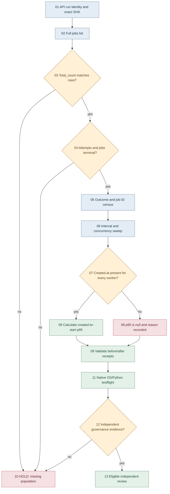

# W75 — Source-bound native fan-out and adverse-provenance DAG

## Purpose

Expand the retained `mip_native_fanout.py` read-only telemetry layer.
Qualify DAB **proposal jobs**, not authenticated CODEX Crew.
Canonical BD root decisions remain in #1929; admission in #1860.

## Directed flow and dependency control

## SIPOC and MIP lane ownership

| Kind | Contract |
| --- | --- |
| Supplier | GitHub REST run/job metadata, no mutation token |
| Input | Run, attempt, head, job ID, timestamps, conclusion |
| Process | Validate, de-duplicate, sweep and percentile |
| Output | JSON, HTML, Markdown and focused CI receipts |
| Customer | MIP run controller, #1860 and #1929 reviewers |

| Lane | Writer | Bound |
| --- | --- | --- |
| W72 | Cohort source owner | 3.10/3.12 cohort first-red |
| W73 | P41 source owner | Git status and nonzero CLI |
| W74 | Red-root source owner | Withheld zero and source logs |
| W75 | Fanout source owner | Native proposal telemetry |
| P0 | Repository administrator | Effective protected main |

## Metrics and conditions

- Worker count: exact distinct `job_id` population, not GH API page size.
- Outcomes: success, failure, cancellation and all terminal categories.
- Peak concurrency: interval event sweep with end events before starts.
- Execution p95: nearest-rank completed job duration on one source run.
- Created-to-start p95: a job-metadata proxy, not full workflow queue.
- Missing job `created_at`: p95 is `null`, not zero or a guessed delay.
- Run ID, run attempt and actual head are carried in separate fields.
- Reverse checks reject changed digest, false success or fake run URL.
- Six-cell attempt: Python 3.10 TOML and Windows path first-reds.
- The classified existing MIP flight owns new focused coverage.
- Broad OS/Python full-CI cells remain a different execution cohort.
- Native qualification cannot create a human approval or merge credit.

## SPINE / SPLINE acceptance

`N0 exact source -> N1 complete run/job input -> N2 adverse tests`
`-> N3 native six-cell matrix -> N4 matched module coverage`
`-> N5 security plus governance -> N6 owner root disposition`.

Hold on missing attempts, incomplete job pages, unrecognized terminal
states, impossible durations, conflicting hashes or absent approval.
All historical and new metrics use separately identified populations.
Do not compare unlike run snapshots as causal scheduling improvement.
