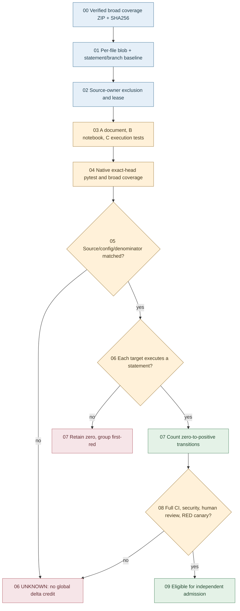

# W77 — zero-covered executable source breadth

## Authority boundary

Coverage cohort: W52 broad B0, 21 Oct 2026, run 39502104581.
Baseline source SHA: 7e9564f955dc00de23a7fba446d776e076758a8e.
W77 source base SHA: 44caccf716a7c20693a2911566289bfc75ea81d9.
All six production blobs agree across these two commits.
Reference: triage/W77_ZERO_ASSET_SOURCE_BASELINE.json.

Historical broad scope: 429 files, 71 executable zero-covered files.
There are another 14 zero-statement files that cannot earn coverage.
The six source targets contain 1,047 unvisited branch/line slots.
Maximum theoretical delta is 1.715156 pp on the frozen denominator.
This is not a forecast or native gain; global-current zero count is UNKNOWN.

## Source-owner lanes (strictly disjoint test paths)

| Lane | Test owner | Production targets |
| --- | --- | --- |
| A | test_w77_zero_document_frontier.py | 2 DMAIC document producers |
| B | test_w77_zero_notebook_reconciliation.py | Notebook + reconciliation |
| C | test_w77_zero_temporal_dow.py | Temporal + DOW executor |

Other active zero-file PRs own DMAIC agents, federation stubs,
version utilities, QPS closure and the W46 comparator.
Those paths are explicitly excluded from the W77 write lease.

## Evidence DAG

## SIPOC and DMAIC / MIP sequence

| SIPOC | Contract |
| --- | --- |
| Supplier | Native broad coverage producer and exact Git blobs |
| Input | B0 artifact digest, six source paths, source head |
| Process | Isolate effects, exercise positive/negative/reverse paths |
| Output | Native test results and matching per-file coverage |
| Customer | ABACUS #1991, #1860 and canonical #1929 |

- DEFINE: six high-yield executable zeros, no untested-orphan inference.
- MEASURE: lock per-file statements, branches and SHA across cohorts.
- ANALYZE: separate missing execution from genuine test defects.
- IMPROVE: mock all dispatch, corruption, exceptions and partial inputs.
- CONTROL: retain native first-red and RED canary as independent gates.

## Acceptance and three pulses

1. P0: original 71/429 frozen zero cohort and byte receipt.
2. P1: six targets reachable on test-only branch, no source edit.
3. P2: fresh native head, each zero-to-positive measurement, branch census.
4. P3: full broad coverage, same source list/config + denominators.

Only P3 with source/context parity can move broad zero count.
Each target is eligible when covered statements rise from 0 to >=1.
Focus coverage toward 100 only once reachable zeros are exhausted.
Stop a locally 100%-saturated target; redirect to new zero assets.

Admission gate stays HOLD: required status rule is absent,
last-push and thread controls remain disabled, bypasses persist.
PR success is not an independent reviewer, REX, or formal closure.
No actual Crew dispatch, Docker mutation, threshold changes or waiver.
