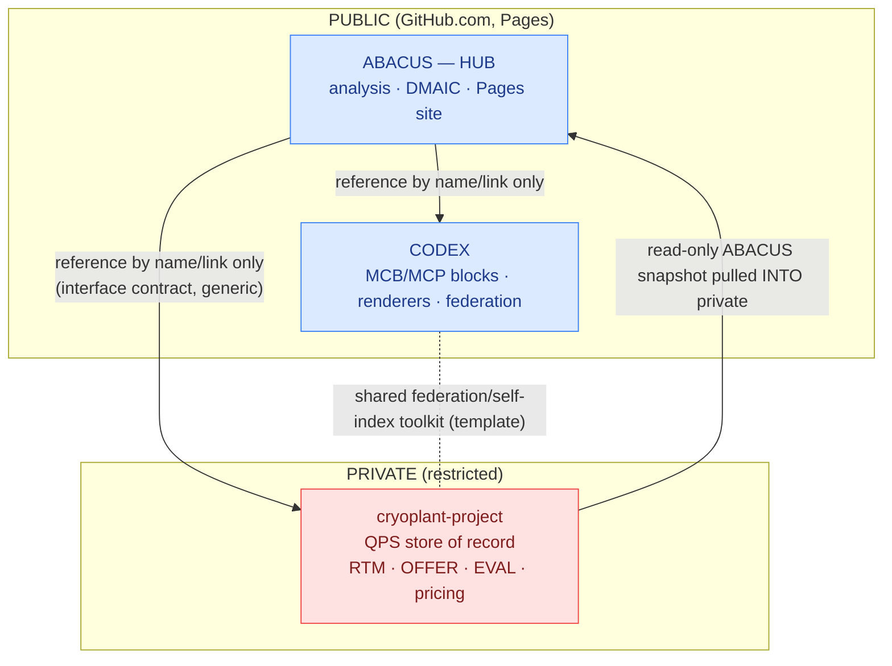

# Cross-Repo Integration Map

**ABACUS is the hub.** It is the public analysis & methodology repository for the QPLANT
cryogenic engineering work at SCK CEN. Two related repositories sit around it, and the
relationship between them is deliberately **hub-and-spoke with a hard public/private
boundary** — not a monorepo and not a set of merged repositories.

This document describes the model, the data/code flows, and the boundary rules. It
references the other repositories **by name and link only**; no content from the private
repository is reproduced here.

## Repositories

| Repo | Visibility | Role |
|---|---|---|
| [`gbogeb/ABACUS`](https://github.com/GBOGEB/ABACUS) | **public** | **Hub.** DMAIC methodology, multi-agent analysis, dashboards, and the GitHub Pages site. The public source of truth for method and navigation. |
| [`gbogeb/CODEX`](https://github.com/GBOGEB/CODEX) | public | Engineering / rendering + federation workspace (MCB blocks via MCP, house-style renderers, governance CI). A sibling, not a child. |
| `gbogeb/cryoplant-project` | **private** | QPS store of record — RTM, OFFER, EVAL, procurement, tender, and pricing material. **Never** mirrored into a public repo. |

## Model

## Flows

- **ABACUS → CODEX / cryoplant-project:** reference only (names and links). ABACUS may
  describe the *interface contract* to the private repo in generic terms, but stores no
  private artifacts.
- **cryoplant-project → ABACUS:** the private repo may pull a **read-only snapshot** of
  public ABACUS content for its own internal use (e.g. under a `tender_library/abacus_snapshot/`
  area). The direction is *into* the private repo; nothing sensitive flows outward.
- **CODEX ↔ cryoplant-project:** these two siblings share a small "self-index / branch-hygiene"
  toolkit. The intended consolidation is a **shared template**, not a merge — the
  public/private boundary must stay intact.

## Boundary rules

1. **No private content leaves `cryoplant-project`.** No RTM/OFFER/EVAL text, vendor names,
   pricing, or document binaries may be copied into ABACUS, CODEX, or the public Pages site.
2. **Reference, don't embed.** Public repos name and link the private repo and describe its
   interface generically.
3. **No binaries in public repos.** Office documents, PDFs, spreadsheets, decks, and archives
   are generated out of a checked-out code/zip bundle — not committed. See each repo's
   `.gitignore`; cryoplant-project additionally uses `BINARIES_MANIFEST.md` + `checksums.sha256`.
4. **Three repos stay separate.** ABACUS is the hub of record for public methodology and
   navigation; CODEX and cryoplant-project remain independent.

## Why not assimilate CODEX into ABACUS?

A content audit (MD5 intersection of tracked `*.py/*.md/*.yaml/*.yml/*.json`) found that
ABACUS and CODEX currently share **no meaningful source** — the only matching files are
empty placeholder stubs. A `git subtree` assimilation would add thousands of unrelated files
and dozens of branches of history for no de-duplication benefit, and would risk importing
CODEX's not-yet-pruned binaries into the public hub. The hub model (link, don't absorb)
achieves the integration goal at none of that cost.
