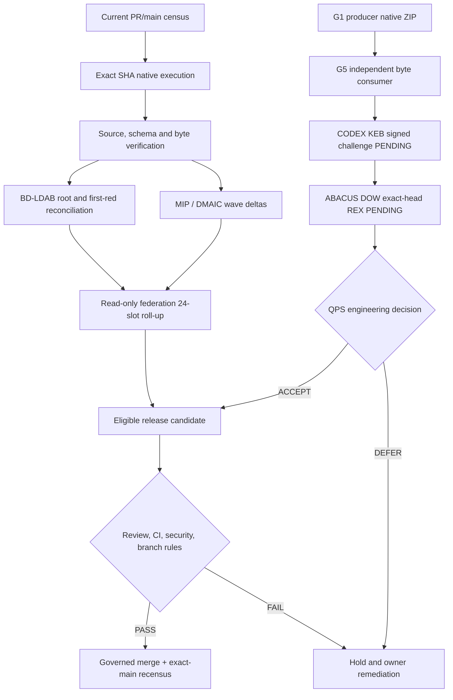

# CODE PURPLE — ABACUS / CODEX / GOGREEN lossless engineering handover

**Cut:** 2026-10-15 (Europe/Brussels) · **Mode:** governed N+1, factual and non-waiving · **Owner PR:** [ABACUS #1990](https://github.com/GBOGEB/ABACUS/pull/1990) · **Companions:** [state JSON](SC_2026-10-15_MIP_MC_STATE_V1.json), [drop-in](SC_2026-10-15_MIP_MC_DROPIN_V1.md), [reusable protocol](LOSSLESS_RESTART_PROTOCOL_V1.md).

> **Authority warning.** This is an immutable observation of pre-handover code heads and explicitly named native runs, **not** a merge decision. Publication of these files changes #1990 head, requiring a new exact-head recensus. `UNKNOWN` is not 0; a merged GitHub PR is not proof of *correctly governed* admission; a green diagnostic is not a fixed operational root.

## 0. Fast resume / decision capsule

ABACUS main `85dad8fbdab530d40e6ccf2f664c455f89454aad`, protected-flag true but active ruleset 24494381 has **required approvals 0 and no required status-check rule**. Open unmerged #1979 baseline head `5bcd24751e9a42a2716a91b77287f1b0aed991ad`, B9 diff coverage 205/211 (97.16%), vs earlier 148/211 (70.14%), **+57 lines, +27.01 pp**, exactly matched denominator. This is **PR changed-line**, not new `main` broad coverage.

Open unmerged #1990 code head *before handover documentation commits* `e62f9ebda6240195fa18a9c471944efa045ff306`. Native MIP testflight [38729033486](https://github.com/GBOGEB/ABACUS/actions/runs/38729033486) SUCCESS, separate artifacts for synthetic fixtures, API metadata, local hash history and read-only federation. Code includes three-repository/8-domain (24 configured slots) census, eleven native fanout unit tests, fifteen federation tests, responsive HTML and SHA-256 input crosswalk. That terminal success is historical after adding handover files.

P0 admission remains HOLD: [#1979 security](https://github.com/GBOGEB/ABACUS/actions/runs/38710428612) is red due to Safety exit 64 and code quality, [A10](https://github.com/GBOGEB/ABACUS/actions/runs/38710428481) blocks two governance files awaiting authorized review, [EVERRED](https://github.com/GBOGEB/ABACUS/actions/runs/38710428581) sees 22 Black formatting candidates, and real independent approval/status-check enforcement is incomplete. No waived security or completed ABACUS admitted merge claimed.

## 1. Evidence source hierarchy and discovered protocols

This handover adapts *process logic*, not stale deployment status, from:
- [ABACUS MissionControl current pointer](https://github.com/GBOGEB/ABACUS/blob/85dad8fbdab530d40e6ccf2f664c455f89454aad/handover/mc2/MISSIONCONTROL_CURRENT.json): repository > chat, cross-SHA substitution prohibited, prior W80/W83 historical cuts immutable.
- [MC2 restart drop-in](https://github.com/GBOGEB/ABACUS/blob/85dad8fbdab530d40e6ccf2f664c455f89454aad/handover/mc2/MISSIONCONTROL_DROPIN_v1.1.md): refresh main/heads, reviewer threads, first attributable completed red, then exact-head remeasure.
- [MC2 session close](https://github.com/GBOGEB/ABACUS/blob/85dad8fbdab530d40e6ccf2f664c455f89454aad/handover/mc2/SESSION_CLOSE_CURRENT.json): prior session-specific W83 and QPS #923 boundaries remain historical; do not treat older SHAs or 0 open PRs as current.
- `deepagent-handover-package/handover/04_handover_manifest.yaml`: manifest/inventory contract, provenance and reproducibility; its QSYS artefact list is not the present MIP project.
- [CODEX Recursive Idempotent Method](https://github.com/GBOGEB/CODEX/blob/9606b61365f4639c9df24961f2cf4ef598cb5d81/docs/handover/RECURSIVE_IDEMPOTENT_METHOD_HANDOVER_v1.md): source hierarchy L0–L4, THINK/IMPLEMENT/VALIDATE modes, change classes E/V/X/T/D and regression checks.
- [G5 N+2 nine-track WBS](https://github.com/GBOGEB/pipeline-automation-hub/blob/61cfb23ce8c08f9c1a6db05bf0ceb1d9e6681456/mission-control/gogreen/g5/N2_NINE_TRACK_WBS.md): evidence-depth distinctions, SIPOC/DAG and falsifiable F01–F04 forecasts.
- This directory's `LOSSLESS_RESTART_PROTOCOL_V1.md` converts those guides into a reusable cold-census / evidence / disposition / publication contract.

Older `handover/README.md` and `HANDOVER_MASTER_INDEX.md` contain 2025 “production ready” statements and conflicting duplicate sections. They are **not current security, CI or merge authority**.

## 2. Repository and PR authority register

| Repository | Default-branch exact SHA at readback | Branch protected flag |
| --- | --- | --- |
| ABACUS | `85dad8fbdab530d40e6ccf2f664c455f89454aad` | true; effective required checks missing |
| CODEX | `9606b61365f4639c9df24961f2cf4ef598cb5d81` | false |
| cryoplant-project | `8582a9e1da8aaa67e85ecd2da7aee98ffbbced50` | false; private |
| pipeline-automation-hub | `f931e443cafae8b286b149ae4331a0326298730a` | false |

| PR / issue | Live disposition | Owner / next proof |
| --- | --- | --- |
| [ABACUS #1990](https://github.com/GBOGEB/ABACUS/pull/1990) | OPEN, unmerged, not draft; code head `e62f9e...` prior to handover | Current handover branch will advance head; re-run CI and reviews before any admission |
| [ABACUS #1979](https://github.com/GBOGEB/ABACUS/pull/1979) | OPEN, unmerged; `5bcd2475...` | Coverage B9 green; A10, Safety, code-quality, EVERRED remain independent reds |
| [ABACUS #1989](https://github.com/GBOGEB/ABACUS/pull/1989) | OPEN, unmerged; `7c93c5d54e5e790f0066cfbe79e5416508262ebb` | PCA/BT statistical qualifications require native observations and exact-head readback |
| [ABACUS #1993](https://github.com/GBOGEB/ABACUS/pull/1993) | OPEN, unmerged; `3bd744a6e057e4df4d26edb2149f987f54678f7e` | Separate DOW diagnostic fixture evidence; do not merge first-reds into #1990 |
| [ABACUS #1928](https://github.com/GBOGEB/ABACUS/pull/1928) | MERGED 2026-10-14; merge `b466c1d73004a474ab081019e9e0e9c6d4d2b6e9` | Pandoc source repair integrated; fully governed admission not independently certified |
| [MissionControl/G5 #534](https://github.com/GBOGEB/pipeline-automation-hub/pull/534) | MERGED 2026-10-15; merge `d99750e694cc0dfcff4e138e583c5a4366e10a0f` | G1→G5 consumer verified; cross-repo/QPS acceptance still DEFER |
| [MissionControl #537](https://github.com/GBOGEB/pipeline-automation-hub/pull/537) | MERGED; merge `210f0b7f9a8f7fff41e6c49f2053f0afb4b40647` | Flight Deck / presentation owner, not a competing evidence SSOT |
| [ABACUS #1860](https://github.com/GBOGEB/ABACUS/issues/1860) | OPEN; checklist **0/12 checked** | Recovery and governed admission; keep open |
| [ABACUS #1929](https://github.com/GBOGEB/ABACUS/issues/1929) | OPEN | BD–LDAB evidence join, unique root census; keep open |
| [CODEX #975](https://github.com/GBOGEB/CODEX/pull/975) | MERGED, inventory-generation repair | NOT authenticated mission dispatch |
| [CODEX #977](https://github.com/GBOGEB/CODEX/issues/977) | OPEN; **0/7 checked** | Authenticated Crew execution promotion; no transport authority |
| [CODEX #1037](https://github.com/GBOGEB/CODEX/issues/1037) | OPEN | P0 CODE PURPLE current red / exact-main review |
| [MissionControl #153](https://github.com/GBOGEB/pipeline-automation-hub/issues/153) | OPEN | Cross-fleet issue and BD registry, not automatically closed by G5 PR merge |

ABACUS GitHub metadata: **53 open issues, 246 closed issues, 35 open PRs** at snapshot. These do not establish distinct open/closed BD root counts; operational unique root counts are UNKNOWN, not 53/246.

## 3. Six-track MIP/DMAIC execution register

### T1. Per-wave metrics and scope

The same **211 eligible changed-line** B9 scope was measured across three ABACUS #1979 heads. Source: [native Wave3 Python 3.12 job #116340251466](https://github.com/GBOGEB/ABACUS/actions/runs/38710428362/job/116340251466).

| Pulse | Exact source SHA | Covered / eligible | Diff % | Uncovered | State |
| --- | --- | ---: | ---: | ---: | --- |
| W0 | `0362c028cfb9656a3a5e17e6a91ff451b54fdefd` | 148/211 | 70.14 | 63 | Historical, matched |
| W2 | `1a9318692f372dc4f50e2bc93e7ac0679e03c625` | 179/211 | 84.83 | 32 | Verified |
| W3 | `5bcd24751e9a42a2716a91b77287f1b0aed991ad` | 205/211 | 97.16 | 6 | Verified |

Totals: **+57 covered lines**, **+27.01 percentage points**, **−90.48% remaining missed lines**, same denominator. Ten W2 and twelve W3 test cases executed under native matrix. `main` broad coverage did not change as a result of an unmerged PR. An older claimed 21,391/39,139 = 54.65% must be remeasured at current exact main under the same source set before crediting change.

### T2. Coverage depth and quality

The Wave2 modules `comparable_coverage.py`, `os_compat_receipt.py`, `safety_exit_census.py` reached **100% of changed lines** and `bd_ldab_evidence_join.py` 96.2%. Wave3 expanded `mip_bminus1_admission.py` and `a10_origin_census.py` fail-closed cases: missing/duplicate JUnit, malformed SHA, incomplete receipts, revoked or absent approvals, unknown confidential reasons. Those are **negative controls**, not operational root closure. Remaining PR uncovered B9 lines: 6 at 211-line scope. Targets 80% and 95% met; broad repo main coverage MISSING/UNKNOWN.

### T3. Execution fan-out, depth and timeline

| Native DAB proposal wave | Run | 8/8 | Summed job s | First-to-last s | Idle gaps s | Peak | Work-time/elapsed |
| --- | --- | --- | ---: | ---: | ---: | ---: | ---: |
| W1 | [38703698730](https://github.com/GBOGEB/ABACUS/actions/runs/38703698730) | PASS | 69 | 45 | 12 | 6 | 1.53 |
| W2 | [38708850371](https://github.com/GBOGEB/ABACUS/actions/runs/38708850371) | PASS | 78 | 85 | 44 | 5 | 0.92 |
| W3 | [38710428385](https://github.com/GBOGEB/ABACUS/actions/runs/38710428385) | PASS | 87 | 27 | 0 | 6 | 3.22 |

W2→W3: 58 seconds faster elapsed (68.2%); 44 idle-gap seconds removed, **causal scheduling explanation unverified**. These are eight **GitHub DAB proposal jobs**, not eight authenticated autonomous remediation workers. No worker-hour ROI credited. Run/job metadata on #1990 uses `tools/mip2/mip_native_fanout.py` with 11 native regressions and JSON/MD/HTML outputs.

### T4. Security and failure repair — disjoint BD-queue

- **P0 A10** [run 38710428481](https://github.com/GBOGEB/ABACUS/actions/runs/38710428481), [job 116340158217](https://github.com/GBOGEB/ABACUS/actions/runs/38710428481/job/116340158217): `ci/governance/workflow_policy.json` and `docs/ci/WORKFLOW_RATIONALIZATION.md` blocked for restricted content; requires **authorized confidentiality review** and canonical regeneration. No automatic content bypass.
- **P0 Safety** [CI/CD 38710428612](https://github.com/GBOGEB/ABACUS/actions/runs/38710428612), [job 116340159325](https://github.com/GBOGEB/ABACUS/actions/runs/38710428612/job/116340159325): `Safety is red`, exit 64; the finding count and dependency ownership classification remain UNKNOWN until native machine report inspected.
- **P1 Black/isort on #1979**, [job 116340159746](https://github.com/GBOGEB/ABACUS/actions/runs/38710428612/job/116340159746): broad Black 754, PR-touched Black 15 across 18 PR-changed Python files; isort broad 477 / PR-touched 9; critical Flake8 0 on same job. Both upstream/source and formatting changes should be disjoint, with no weakened ratchet. Broad and changed-file counts have different scopes.
- **P1 EVERRED V3** [run 38710428581](https://github.com/GBOGEB/ABACUS/actions/runs/38710428581): 22 code files would be formatted, 19 would be unchanged; neither constitutes closure or exact-main reduction.
- **P2 historical scanner census**: DAB Flake8 2,945 (old), style queue 2,346 (old) and 3,118 (newer different snapshot). Bandit full 6,333 (old) and 6,609 (newer PR snapshot); configured 3 findings. **No comparable opened/resolved delta** is credited until exact source/config/scope/tool fingerprints are aligned.
- **P0 governance**: ABACUS `protected=true` but active ruleset `24494381` has `required_approving_review_count=0`, stale review dismissal and last-push review; no `required_status_checks` rule. Latest #1979/#1990 reviews observed `COMMENTED`, not eligible approvals. Formal admission HOLD.

All recorded roots remain OPEN or UNKNOWN unless their own native closure proof exists. A passed MIP diagnostic is not an A10 or Safety fix.

### T5. MIP / REX / LDAB–LLDB / 3P* / PCA–BT

Native [#1990 MIP testflight 38729033486](https://github.com/GBOGEB/ABACUS/actions/runs/38729033486) SUCCESS on code head `e62f9ebda6240195fa18a9c471944efa045ff306`; four separately uploaded evidence types:

| Artifact class | GitHub artifact ID | Interpretable proof |
| --- | --- | --- |
| SYNTHETIC_CONTROL | 11970121246 | Negative controls, **not** live roots |
| API_METADATA_ONLY | 11969736833 | Genuine GitHub run/job records and durations; input SHA-256 crosswalk |
| READ_ONLY_FEDERATION | 11969621979 | Three repos × eight domain slots, local bytes/status separately classified |
| LOCAL_HASH_HISTORY | 11969536961 | Deterministic local receipt/history integrity, **not** native REX |

A tested HTML telemetry view exists under `tools/mip2/mip_native_fanout.py`; separate 24-slot HTML census in `tools/mip2/mip_federation_census.py`, attached to workflow `.github/workflows/mip-wave-pulse-testflight.yml`. **#1990 remains unmerged and new handover commits require new exact-head tests.**

LDAB/LLDB: lexical/debugger-file discovery is not an executed LLDB session or repaired process root. PCA/Bradley–Terry require independent, comparable native samples; process-stability M2 and capability M3 remain HOLD. 3P* / W64-W79 native workflow passes are contract evidence, not automatic statistical certification or operational dispatch.

### T6. Federated GOGREEN lineage and QPS receiver

The user-supplied N+2 evidence documents a **real same-repository G1→G5 consumer replay**:
- G1 producer archive artifact ID `11968217957`, bytes SHA-256 `f926b86d377f989cfb380c587ce5cbf2843a3e7e152d0df3c4d8a3a914ba2117`; source `63d1ac9618b2612d0ec3ceb32faad3841413b79d`; run `38726158685`, job `116392416193`.
- G5 native consumer [run 38728223274](https://github.com/GBOGEB/pipeline-automation-hub/actions/runs/38728223274), head `6ca8bea048982d3aff44689da0dd7ce2e355f60f`, **44/44 original + 10/10 new negative tests PASS**.
- G5 output artifact ID `11969036514`; SHA-256 `5ed6556012d1666ce0d4d686237a56e27b1ff3e1d455d8bda93433994a3a0c6e`. Archive and internal member SHA-256, provenance, JSON/HTML identity verified according to N+2.
- Later polished G5 head `61cfb23ce8c08f9c1a6db05bf0ceb1d9e6681456`, [terminal native consumer workflow 38728626693](https://github.com/GBOGEB/pipeline-automation-hub/actions/runs/38728626693) PASS.
- Since that snapshot, G5 [#534 was merged](https://github.com/GBOGEB/pipeline-automation-hub/pull/534), with merge SHA `d99750e694cc0dfcff4e138e583c5a4366e10a0f`. Its N+2 “open/unmerged” line is superseded; its original consumer-proof details remain historical observations.

**Noncompensating boundary:** same-repo verified consumer hops=1; authenticated CODEX/KEB→ABACUS/DOW cross-repo hops=0 proved; QPS-accepted links=0; recipient QPS decision=DEFER. The 42-cell families, 66-cell surfaces, and new 24-slot ABACUS/CODEX/cryoplant configuration are **different populations**. MissionControl controller still declares `mutation_enabled=false` and no enabled external mutation transport. cryoplant-project's private status must not be silently represented as an API-ready runtime.

GOGREEN WBS nine tracks (measurement, QPS coverage, GOGREEN, breadth/depth, runtime economics, first-red, control/stability, MIP/PCA/BT/3P*, telemetry/HTML) remain owner-specific. [MissionControl #153](https://github.com/GBOGEB/pipeline-automation-hub/issues/153), [ABACUS/LDAB #1929](https://github.com/GBOGEB/ABACUS/issues/1929), [CODEX/KEB #1037](https://github.com/GBOGEB/CODEX/issues/1037) are crosswalks, not proof of a completed four-hop chain.

## 4. Diagnostic DAG (evidence authority is not transitive)

The diagram represents intended topology. Only G1→G5, select native PR testflights, and read-only census are evidenced; pending edges are not executed.

## 5. Synchronized TODO / BD dispositions

| Work ID | Class | Last verified | Status | What closes it |
| --- | --- | --- | --- | --- |
| MC-P0-01 | Admission governance | protected true, required checks absent, approval count 0 | BLOCKED | Owner-configured required statuses + eligible review, then effective readback |
| AB-SEC-01 | A10 confidential content | 2 files blocked | BLOCKED | Authorized restriction review and canonical generated inventory with exact SHA |
| AB-SEC-02 | Safety exit 64 | run 38710428612 failure | BLOCKED | Source-scoped native Safety machine report + attributable remediation |
| AB-QUAL-01 | Changed Black/isort debt | 15/9 PR-touched; 754/477 broad | BLOCKED | Own disjoint formatting PR + new-head native ratchet |
| AB-QUAL-02 | EVERRED format candidates | 22 candidates | BLOCKED | Format verified files only; exact-head producer + tests |
| AB-COV-01 | B9 changed-line threshold | 205/211 = 97.16% on #1979 | VERIFIED (PR scope) | Already meets PR B9 criterion; main impact remains separate |
| AB-COV-02 | Main broad coverage change | newer matched main result absent | UNKNOWN | Scope-matched exact-main coverage receipt |
| AB-MIP-01 | Wave history and telemetry | #1990 native pre-handover SUCCESS | VERIFIED on historical code SHA | Re-verify new head and inspect actual artifact bytes |
| MC-OPS-01 | Eight worker fan-out | W1/W2/W3 8/8; 45/85/27s | VERIFIED descriptive | Causal scheduling claim requires independent runner timings |
| FED-01 | CODEX/ABACUS Crew dispatch | no authenticated dispatch receipt | UNKNOWN | Explicit dispatch ID + run/job/attempt + verified result bytes |
| FED-02 | G1→G5 replay | Consumer native pass and byte evidence | VERIFIED SAME-REPO | No new closure required; do not conflate with FED-01 |
| FED-03 | QPS ACCEPT | no recipient acceptance | DEFER | KEB→DOW→QPS recipient proof + owner verdict |
| MC-ROOT-01 | Deduplicated open/closed BD roots | unknown | UNKNOWN | Root fingerprint census, reopen/closure proof independent of issue count |
| MC-HANDOVER-01 | Durable lossless continuation | Protocol/state/handover/drop-in being committed | IMPLEMENTED | GitHub readback + head recensus + receiver acknowledgment |

No related open recovery issue is closed in this handover. Merged PRs #1928 and #534 should remain historically merged; add cross-link comments, not retroactive merge promotion.

## 6. Next admissible execution, in order

**P0 Cold start:** refresh all four default branches and #1990/#1979/#1989/#1993 current heads. Compare against this cut. If SHA changed, do not credit earlier terminal jobs on new SHA. Inspect final #1990 handover-commit check run, its four artifact classes, current errors and review comments.

**P1 Source-owned first-red:** classify #1979 A10 separately from Safety and Black; confidentiality change requires owner approval and should not be automated. Repair attributable Black and isort in a separate branch; run negative tests and source diff. Recompute result denominators; root closures remain 0 credited pending accepted evidence.

**P2 Measured coverage:** use 205/211 as verified PR B9 baseline only for same source scope; target six remaining uncovered lines if high-value branches remain. Do not dilute priority by chasing 100% at expense of security. Re-measure broad main with own actual source/test cohort.

**P3 Observability/scale:** use #1990's native job output JSON/HTML for consecutive W1→W2 and W2→W3; identify no-job intervals versus GitHub runner queue time. Add stable source/run/job/artifact hash and error fingerprints, not extra fabricated workers.

**P4 Federation:** integrate genuine byte-validated G1→G5 proof as immutable input, then challenge CODEX KEB, ABACUS DOW and QPS recipient independently. Local 24-slot grid remains incomplete wherever source or receipt is missing. Do not turn a local hash into a signed REX.

**P5 Governance:** owner sets required context(s) only after verifying exact names and reliable terminal availability, independent reviewer eligibility and conversation resolution; one-person team may document explicit bounded emergency fallback separately but this handover provides no bypass. Correct main merge only when all effective rules are demonstrably fulfilled.

**P6 Publish new cut:** update state JSON and Markdown together with final SHAs, source checksums, issue comment references and before/after deltas; preserve previous cut verbatim and link successor. Never substitute an issue comment for an evidence artifact.

## 7. No-ZIP receiver contract

Read [drop-in](SC_2026-10-15_MIP_MC_DROPIN_V1.md), [state JSON](SC_2026-10-15_MIP_MC_STATE_V1.json) and [protocol](LOSSLESS_RESTART_PROTOCOL_V1.md). On receipt, state exact current main, PR SHA, B9 cohort, first-red, BD root census completeness, and next bounded owner slice **before changing source**. Commit only reproducible text/source/tests; link native artifacts by run rather than inventing download URLs. Treat CODEX/cryoplant/pipeline-hub repositories as independent authorities.

**Final snapshot classification:** `ABACUS_B9=VERIFIED_PR_SCOPE`; `MIP_NATIVE_TESTFLIGHT=VERIFIED_CODE_HEAD`; `G5_SAME_REPO_CONSUMER=VERIFIED_HISTORICAL`; `CROSSREPO_REX=UNKNOWN`; `QPS_ACCEPT=DEFER`; `GOVERNED_MAIN_ADMISSION=HOLD`; `OPERATIONAL_BD_CLOSURES=UNKNOWN`.
