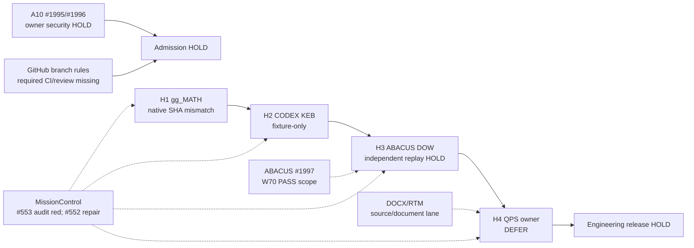

# CODE PURPLE N+3 Pulse 2 — append-only CONTROL readback

Snapshot: 2026-10-15T17:09Z approximate multi-request non-atomic; every GitHub status is an observation, not an eternal assertion. This appendix is **evidence only**, not a new SSOT or QPS approval.

## Source-linked census

- [Full six-repo branch and open-PR census](./NPLUS3_PULSE2_BRANCH_PR_FULL_20261015.json): 642 exact branch refs; 47 open PRs (45 ABACUS and 2 MissionControl); 596 branch refs without a current local open PR. #1990 -> #2005 child-base dependency, #2010 shares #2005 head and is separately open against main. NO PR closure or branch prune.
- [Six-repo open issues and canonical BD root crosswalk](./NPLUS3_PULSE2_ISSUES_ROOT_CROSSWALK_20261015.json): 142 non-PR open issues at sampled request, plus 47 PRs in the issues collections. Textual references are not verified dependency edges. Preserve all historical BD records.
- Repository head readbacks sampled within this pulse: gg_MATH main c5cd3e30a8e241111fc9f15367f3b92ba0393ea7; CODEX main 4fa9d77018fcb44324bbc57b0bc9d96336951ce3; ABACUS main 54da377cf82a358ac97903ecde0270c975b8fcc1; QPS main f87f8e2933c85a75cae85892848291701e1c8208; MissionControl master 3b468f1e1f161a64566eb85c104335c40411153b; DOCX_RTM_Automation main 252a6845821ac3981d680730f22beb0b0cae8440. These six heads were not fetched atomically; recheck before admission.

## W70 native producer — success verified, root closure not inferred

- ABACUS PR #1997 exact head `e2d25f9a282c81b84a89727f529c2ca8e55f484f`.
- Run [38772568864](https://github.com/GBOGEB/ABACUS/actions/runs/38772568864), attempt 1, job 116551902805, terminal **PASS**; 21/21 unit tests.
- Native W70 producer scope `tools/w70_wave_pulse_metrics.py` at source digest `8a576995ced65b417869b58822691166b481813fe13f5ca7f67084b1fa3ccac7`.
- Actual coverage: lines **119/119 (100%)**, branches **15/16 (93.75%)** with coverage.py 7.13.3. Combined coverage 99.26%; do not round combined to 100%. 88/100 and 24/30 from unittest output were synthetic fixtures.
- Artifact 11992955283, outer ZIP SHA256 `e693b20f3440d03cd9e7e538bd638a9756cafb3093548fdfed6124620f7f2acd` (matches GitHub artifact digest), 4623 bytes, ZIP CRC PASS, eight inner JSONs inspected. Inner `W70_COVERAGE.json` SHA256 `fe7585b39f44916f6304c16e18630e5af50923f2ef497e4d0f4d6b78fb39d111`; `W70_METRICS.json` SHA256 `f142d89e415c971dc8c5e719204252603040d5d0255abff3128b84b7e177a111`. Receipt_sha256 field `b5313cc938ba39f02735f3fe8c4fd317e5c223c3aa94ba0107a8ddbccc7fc400`.
- A-E manifestations 76 (31 open/45 closed), not unique confirmed root IDs. Native receipt correctly states `unique_confirmed_roots:null`, `native_run_authenticated:null`, `integrated_main_verified:null`, `admission:HOLD`. These receipt fields are **not** automatically promoted by independent inspection.
- Previous W70 producer first-red at run 38750675077 is HISTORICAL/SUPERSEDED for dedicated producer; broad #1997 Code Quality, Security, docs and Feedback Gate failures still separate, so no overall PR root-resolved or merged claim.

## Root controls / dependency ordered

1. SOURCE_TUPLE_MISMATCH [H1-H4]: Archived H1 native proposal carries `producer.source_sha=3f19c7bde2c1ba7484cfe17028eb7e2064a40a61`, while H2/H3 downstream fixtures carry `2f84623180bafbd582f90febb542381ed9ce679e`. Same graph digest does not authenticate replay. CODEX #1049 merged but no fresh authenticated four-hop reentry verified. Owner QPS #1920 stays DEFER.
2. REQUIRED_CHECKS_MISSING [admission]: ABACUS rule #24494381 ACTIVE, pull_request approval count **0**, status-check rule **ABSENT**; other five lane defaults lack active rules at readback. Rule update requires authorized admin configuration and REST readback. Never mark green on the basis of a single workflow.
3. RESTRICTED_CONTENT [A10]: ABACUS issue #1996 open, zero issue comments, #1995 two unresolved inline threads; restricted policy/report content requires exact-file authorized security disposition. No waiver/auto-allowlist.
4. MATPLOTLIB_PY310 [ABACUS]: PR #2025 failing Python 3.10 dependency install because `matplotlib>=3.11.2` has no matching 3.10 distribution. Two proposed fixes #2024/#2026 overlap by root; deduplicate and await source-owned terminal tests, do not merge both blindly.
5. M3_ZERO_TEST_AUDIT [MissionControl]: #553 audit job 116553545827 failed with `UNRESOLVED: code-purple-m3-lossless.yml :: python -m unittest (invalid YAML)`; 35/36 gate checks passed. Existing source-owned #552 repairs M3 workflow. Treat #553 self-tests PASS separately from inherited audit red.
6. QPS_PHYSICAL: eight original physical source byte/size proofs missing from owner environment; do not substitute generated binaries or approve design/safety conditions.

## Measured readiness and qualified statistics

| Cohort | Evidence | State |
|---|---|---|
| QPS two-module P0 / P1 / P2 | Lines 93/135 -> 132/135 -> 135/135; branches 36/48 -> 45/48 -> 48/48; native historical runs 38705702993, 38706275711, 38707522432 | Scoped latest historic 100/100 only |
| ABACUS W70 native head e2d25f9 | 119/119 lines, 15/16 branches, 21/21 tests | EXECUTED; artifact verified; not integrated |
| Six-repo typed Flight Deck | Historical 6 observed /42 declared, 36 UNKNOWN | Needs new native cell census |
| Main protections | ABACUS ineffective checks, five other default branches unprotected | HOLD |
| PCA, Bradley–Terry | Independent complete samples, connected paired comparison graph missing | NOT READY |
| Real 3P*/Crew, LLDB/LDAB | No new authenticated worker/debugger session tuple | NO CREDIT |
| Unique root burndown, runner p95 | No matched genuine observations/denominators | UNKNOWN |

## Source-linked dependency DAG

## Disposition

`IMPLEMENTED`: W70 code and M3 repair branches exist; `EXECUTED`: W70 producer native PASS; `VERIFIED`: W70 local artifact byte/hash provenance; `ROOT_RESOLVED`: not yet granted; `INTEGRATED`: not for these PRs; `ENGINEERING_ACCEPTED`: QPS DEFER; `CLOSED`: none newly certified. No rule changes, user-data substitutions, branch deletion, PR merge, A10 waiver, or QPS approval made by this census.
