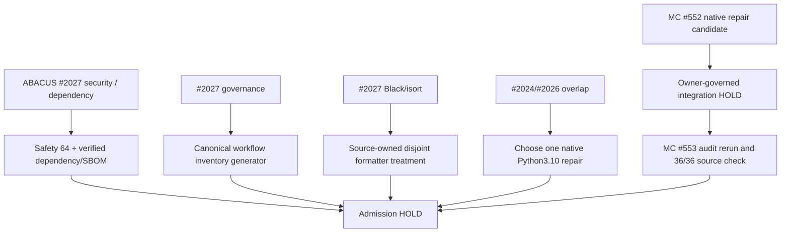

# CODE PURPLE N+3 — Pulse 3 exact-head first-red readback

Read-only GitHub inspection on 2026-10-15 around 18:10 UTC. **Non-atomic observations; revalidate before admission.** This is an append-only measurement appendix under existing PR #2006, not an alternative SSOT.

## Exact heads and check populations

| Repo / PR | head SHA | completed-success | completed-failure | in progress / queued | scope |
| --- | --- | ---: | ---: | ---: | --- |
| ABACUS #2027 | `8cb4d742ad046ab688d691f4cc68c4171ad4308f` | 53 | 12 | 0 | 75 retrieved check runs; 9 skipped, 1 other |
| ABACUS #2024 | `4aae61e3cfd52061e1183db4b3281a77b22fd5c0` | 25 | 0 | 41 | 69 retrieved check runs; still nonterminal |
| ABACUS #2026 | `884212de9cdf9b168a41d8ea254d006bc3421690` | 1 | 0 | 56 | 59 retrieved checks; moving head supersedes earlier #2026 |
| MissionControl #552 | `e6af43090993155416ac843cb656f862ba5eb272` | 11 | 0 | 0 | 12 retrieved checks; one skipped |
| MissionControl #553 | `077ba96169a359621ac86e91f44a42348c8610a1` | 9 | 1 | 0 | 12 retrieved checks; two skipped |

These are retrieved check-run populations, not complete effective required-status checks or independent reviewer approval.

## P0 root triage

### #2027 first-reds remain disjoint

- [Security Scanning job 116558942054](https://github.com/GBOGEB/ABACUS/actions/runs/38774624178/job/116558942054): runner successfully installed setuptools **84.0.0**, but scan exits nonzero. The security job's Safety execution returned **64** and summary preserved security red. Do not interpret a dependency tool install as Security PASS. Native log mentions NLTK package; unresolved vulnerability/dependency finding requires original Safety report and `pip check` readback, not invented counts.
- [policy-and-inventory job 116558942393](https://github.com/GBOGEB/ABACUS/actions/runs/38774624108/job/116558942393): unit test rejects unclassified `code-purple-dashboard-v31.yml`, `code-purple-sut-gui.yml`; canonical `docs/ci/WORKFLOW_RATIONALIZATION.md` stale. This is governance-generated inventory/root, not Safety or source-selection.
- [Code Quality job 116558942372](https://github.com/GBOGEB/ABACUS/actions/runs/38774624178/job/116558942372): independent full-scan BLACK and ISORT required failures; no blanket root closure. The scan is not evidence that #2027 itself introduced all legacy formatting debt.
- [Python compatibility gate job 116568524868](https://github.com/GBOGEB/ABACUS/actions/runs/38774624124/job/116568524868): proof incomplete; independent Python3.10 install failure historically showed `matplotlib>=3.11.2,<4.0.0` unavailable in the interpreter cell; #2024 and #2026 are overlapping repair contenders, not two distinct closures.
- PR Feedback Gate, bridge unit, static analysis, responder and full red summary also fail; deduplicate scanner/config signatures before attributing causal roots.

### MissionControl native first-red

- [#553 audit job 116573036984](https://github.com/GBOGEB/pipeline-automation-hub/actions/runs/38778726684/job/116573036984) reports `UNRESOLVED: code-purple-m3-lossless.yml :: python -m unittest (invalid YAML)`; 35/36 audit gates passed. Other #553 checks succeeding is not a release-admission override.
- #552 exact head `e6af43090993155416ac843cb656f862ba5eb272` has 11 successful /1 skipped from 12 retrieved checks and contains source-owned M3 workflow reconstruction. It is OPEN and NOT INTEGRATED. After authorized integration, recensus #553 exact main and rerun audit; do not duplicate M3 source repair.

## Dependency and authority sequence

**DoD/DoV:** IMPLEMENTED on branches is not ROOT_RESOLVED. Native success on dedicated tests is not integrated-main proof. No security waiver, branch prune, reviewer approval, merge or QPS engineering decision is claimed. Retain prior N+1, N+2 and N+3 snapshots unmodified.
