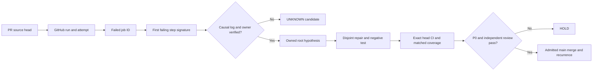

# CODE PURPLE CBD: native job DAG, SIPOC and growth proof

Status: **diagnostic implementation, admission HOLD**.

This document supplements the existing [CBD 260 wave charter][cbd-charter].
It does not replace EVERRED V3 or the [BD/LDAB root owner][bd-owner].

## N0 and N1 observations

The frozen 16 October 2026 N0 sample contains:

- 75 PR records, 74 open during non-atomic readback.
- 260 failed-workflow associations.
- 253 distinct failed run IDs and seven duplicate PR/run aliases.
- 19 workflow-name buckets, not 19 causal roots.
- Native job-step readback: 253/253 observed runs.
- 492 failed-job observations in those runs.
- 67 workflow/job/first-failed-step signature candidates.
- Run attempts: 227 attempt 1, 23 attempt 2, two attempt 3,
  and one attempt 4.

The native job data come from the previous #2077 source-bound
[workflow run][source-run] and [artifact][native-artifact].
The 492 and 67 values describe this historical sample only.
A subsequent run must regenerate them from its own bytes.
Neither count is a verified open-root denominator.

## Measured coverage growth

The CBD 260 module has a same-source comparison:

- Baseline: 134/153 statements and 33/38 branches.
- PR #2091 initial measurement: 152/153 and 37/38.
- Combined: 167/191 to 189/191, or 87.43% to 98.95%.
- Seven additional tests passed on Python 3.10 and 3.12.
- This is not main or changed-line coverage.

The remaining module main-guard opportunity is separately tested.
Its new exact-head receipt is required before claiming 100% coverage.
The additional job-DAG module is measured in a distinct scope.

## Directed evidence graph

Every edge before causal review is descriptive. The graph projects
PR/run/job/step relationships and the upper bound on PR reach.
Repeated steps and rollup jobs do not automatically become root IDs.

## SIPOC ownership and dispatch

- **Supplier:** GitHub source-bound N0 records; paginated native
  run/jobs metadata from the pre-existing EVERRED V3 reader.
- **Input:** repo, exact head, run ID, attempt, job ID, first failed
  step, trustworthy producer and artifact digests.
- **Process:** N0 census, N1 guarded readback and candidate DAG,
  N2 log-level first-red attribution, N3 disjoint source repair,
  N4 positive and negative tests, N5 governed admission.
- **Output:** candidate DAG JSON, metrics JSON, SIPOC JSON, safe HTML
  and deterministic SHA-256 receipts.
- **Consumer:** [BD/LDAB #1929][bd-owner], DOW, Mission Control viewer,
  and [P0 admission #1860][admission].

The DAG is a derived review surface only. No self-attested root
confirmation or runner-authentication assertion is accepted.

## Sequenced diagnostics and scaling

1. Exact-head metadata: use no more than four read-only scout workers.
2. Rank step signatures by observed jobs and distinct affected PRs.
3. Obtain source-matched job-log proof for the earliest material red.
4. Assign a canonical owner with a non-overlapping source-path lease.
5. Execute no more than two approved independent source repairs.
6. Pair every fix with an adverse test and matched native coverage.
7. Re-read required checks, A10, security and main branch protection.
8. Credit a root only after owner confirmation and a distinct-head
   recurrence or other declared verification contract.

GitHub re-run results are tied to run ID, run attempt, job ID, source
SHA and exact steps. The connected GitHub job-rerun interface does
not expose the Actions debug-logging switch; logs must not be
misrepresented as enhanced debug mode.

## Known independent barriers

Black formatting debt in the EVERRED test lane is real. A separate
repair-producer first-red came from comparing a PR synthetic merge
checkout with the PR head. The source-test checkout is now pinned to
the PR head and audited; full integration remains an independent gate.
Safety, Bandit, governance, A10 and human review are not compensating
controls and are not waived by test pass rates.

Unverified values remain null: formal open/closed causal roots,
authenticated Crew launch, main coverage, diff coverage, and
authorized merge delta.

[cbd-charter]: CBD_260_WAVES_SIPOC_20261016.md
[bd-owner]: https://github.com/GBOGEB/ABACUS/issues/1929
[admission]: https://github.com/GBOGEB/ABACUS/issues/1860
[source-run]: https://github.com/GBOGEB/ABACUS/actions/runs/38961401660
[native-artifact]: https://github.com/GBOGEB/ABACUS/actions/runs/38961401660/artifacts/12073596774
