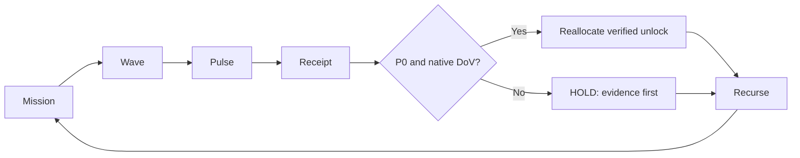

# CODE PURPLE — Mission Cycle v1

Status: **implementation candidate**, admission HOLD. Do not infer authorization
from a diagram, priority, model score, action selection or historical PR merge.

## 1. Canonical scope — one method, several consumers

| Layer | Ownership | Contract |
|---|---|---|
| CODE PURPLE | Mission policy and operator sequence | This document and DAG |
| ABACUS EVERRED | Root/evidence ledger and metric projections | `src/mission_cycle.py`; `src/unlock_yield.py` |
| MissionControl | Worker staging, disjoint leases, issue queue | Consume decisions; never own root truth |
| CODEX | UI/graph provider and empirical PCA/BT fitting | Federate versioned receipts only |
| MIP / DMAIC | Verification and improvement gates | Independent DoV; no implicit promotion |
| Repository admin | Server-side admission protection | GitHub rulesets/reviews/status checks |

Do **not** copy scoring or admission logic into every repository. Consumers
shall refer to the single canonical method with exact version/SHA. Nothing
here changes CODEX's graph APIs, MissionControl's worker authority or the
existing EVERRED event schema.

## 2. Readable operational DAG

Canonical Mermaid source: `diagrams/06_mission_cycle.mmd`.



The detailed native DAG preserves PCA/BT eligibility, confirmed reverse
pressure, independent gate checks, and the source-bound receipt boundary.

## 3. Main operator presentation sequence

Click the P badge or issue heading. Expose one compact submenu:

1. **Why this ranks** — P0 safety/governance overrides empirical analytics.
2. **What it unblocks** — list only confirmed reachable mandatory gates.
3. **Next action** — bounded repair or proof acquisition with an owner.
4. **Decision** — Yes / No / Pending; optional proposed P0–P3 priority.
5. **Comment** — local justification.
6. **Prepare record** — local JSON only; not a GitHub issue write.

Source logs, exact SHA/run/job, PCA loadings, BT pair receipts, longer DMAIC
history and full DoV belong in expandable evidence leaves. `UNKNOWN` must
not be rendered as zero, success, or visually green.

## 4. Reverse pressure and Unlock Yield

Reverse pressure measures confirmed reachability to mandatory gates in
`model_readiness.reverse_pressure`, not expected success probability.
It requires a DAG of confirmed root IDs, supported edges and no cycles.

`Unlock Yield = 100 * N / D`, where **N** is the number of downstream
mandatory dependencies that moved BLOCKED -> READY and **D** is the complete,
comparable eligible dependency census for the root. D must equal confirmed
reachable mandatory gates. Before/after receipts must identify different
exact SHAs, matching configuration, repository, gate and native run/job.
External authenticated GitHub readback must validate **every receipt**.
Without it, Unlock Yield is `null / UNKNOWN`; reported association is not
proof the repair caused the transition.

The standalone `unlock_yield.evaluate(..., native_verifier=...)` callable
is a trusted-adapter seam. No browser, CSV import or unsigned JSON can set
the metric to verified. A synthetic test callback is never a deployment
receipt or evidence of a current run.

## 5. PCA, BT, priority, admission

PCA and Bradley–Terry use the existing EVERRED eligibility functions in
`model_readiness.py`. Eligibility to fit is not a fitted score, PC label,
BT rank, probability of repair or issue severity. Without qualified model
outputs, show `PCA=UNQUALIFIED`, `BT=WITHHELD`, and no ranking.

P0 safety, confidentiality and governance are hard gates. Ranking may only
reorder otherwise eligible work. The offline method always returns
`admission=HOLD`; independent review, protection and security remain
server-side GitHub requirements. Worker leases never authorize a merge.

## 6. Reproducible I/O

Input is the existing BD-queue observation JSON from #1959, not another
root ledger. Generated HTML is an operator projection, not a live dashboard.

```bash
python tools/everred_v3/scripts/build_mission_cycle.py
python tools/everred_v3/scripts/build_mission_cycle.py --check
python -m unittest discover -s tools/everred_v3/tests \
  -p 'test_mission_cycle*.py' -v
```

Operator page: `dashboard/mission_cycle.html`. Click title/P badge to
open the decision panel. Controls do not call GitHub APIs or alter issue
priority. Versioned export can later be submitted to MissionControl after
authenticated operator permission and independently verified DoV.

## 7. Promotion and roll-out gate

Current source is a frozen #1954/#1955 analytical BD census. All current
Unlock Yield scores remain UNKNOWN. Do not claim enhanced coverage, root
burndown, live worker counts or branch protection from static UI tests.

Acceptance requires Python 3.10/3.12 focused negative tests, generated
HTML byte identity, native CI, security/quality scans, a qualified reviewer,
and effective protection for each default branch. Then federate an explicit
versioned reader to CODEX and MissionControl. Avoid copying code to child
repositories or enabling remote writes during pilot.
