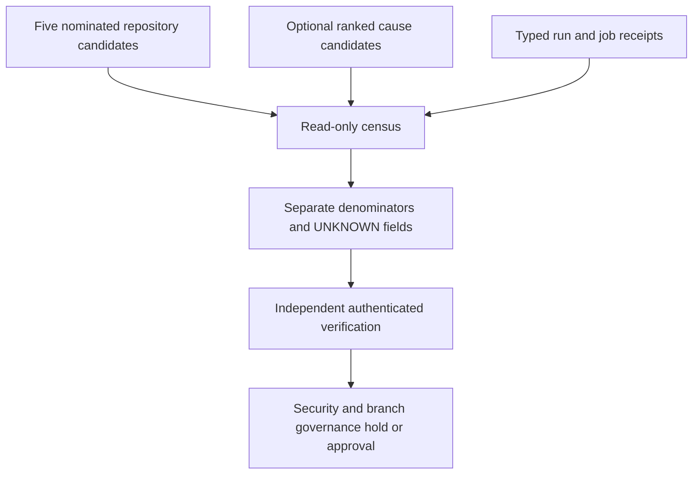

# EVERRED V3: TOP21 read-only deployment / ranking census

Status: implementation candidate; P0 admission HOLD. Source of repository
candidates: `docs/data/code_purple_federation_metrics_contract.json`.

TOP21 is a **ranking capacity**, not 21 deployed repositories or workers.
The source contract currently nominates five repository candidates. Neither
owner-approved TOP21 ranking nor authenticated per-repository deployment is
established by that inventory.

Run:

```bash
python tools/everred_v3/scripts/build_top21_rollout.py \
  --contract docs/data/code_purple_federation_metrics_contract.json \
  --output /tmp/top21.json
python tools/everred_v3/scripts/build_top21_rollout.py \
  --contract docs/data/code_purple_federation_metrics_contract.json \
  --output /tmp/top21.json --check
python -m unittest discover -s tools/everred_v3/tests -p test_top21_rollout.py -v
```

Optional inputs: `--ranking` with schema `abacus.everred.top21.rankings.v1`
and `--receipts` with schema `abacus.everred.top21.receipts.v1`.
All input receipts are typed but **not authenticated**. Exact repository, SHA,
run, job, URL, scanner/coverage configuration, numerator and denominator are
validated for structural consistency only. Coverage denominators are not mixed
across configurations, repos or source SHAs. Zero eligible changed source lines
is N/A, not 100%.

Output has separate `root_ranking` and `repository_rollout` denominators.
`authenticated_deployments`, live worker counts, LDAB sessions and effective
branch protection remain `null` without independent proof. No causal root
identity, owner lease, verified merge admission or security waiver is created.

This component is disjoint from:

- #1947 canonical BD/LDAB producer tests
- #1950 EVERRED source-binding bridge
- #1951 causal replay KPI/model readiness

Local isolated QA of the *full download package* passed 16/16 tests with
100% source-module line/branch coverage. The checked-in condensed regression
suite requires its own exact-head native CI; do not substitute local receipts.



No merge authorization, formal credit, worker dispatch or security acceptance.
